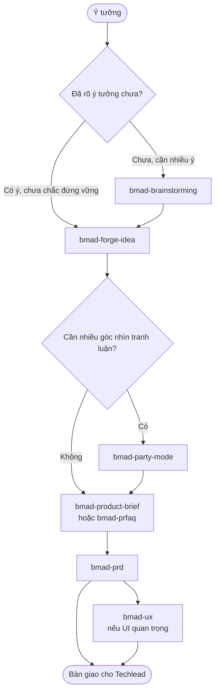
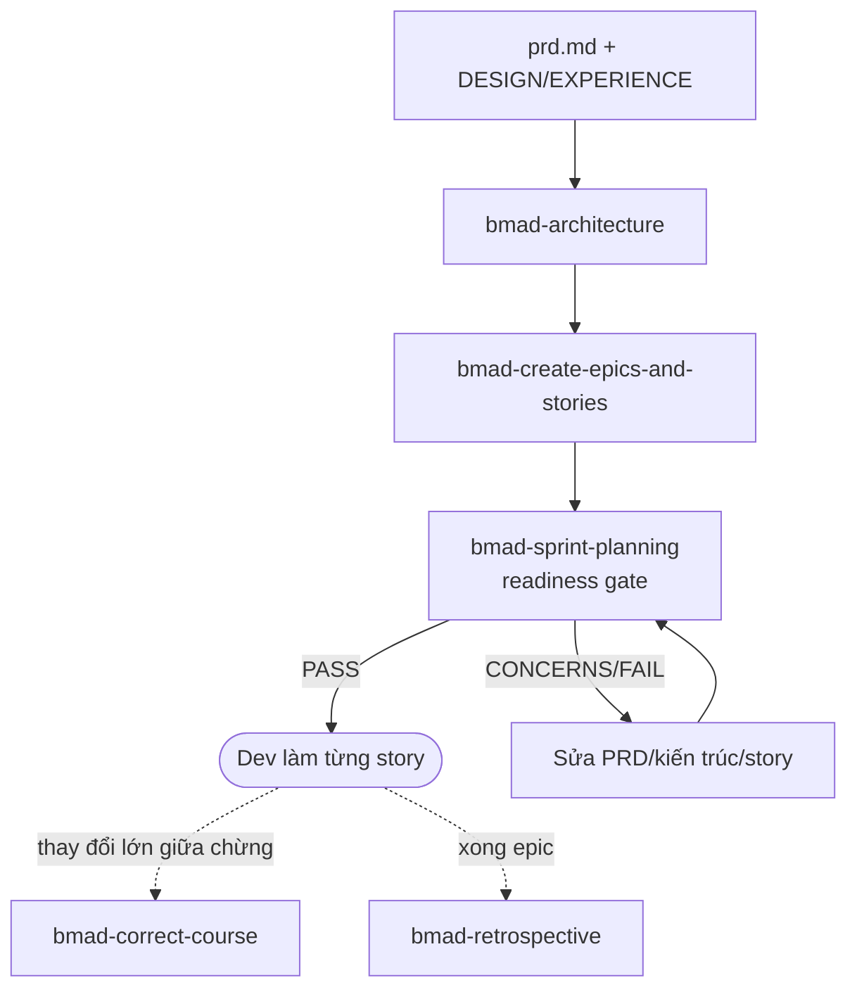

# BMAD Method: nhập môn cho PM và Techlead

Trong bộ tài liệu này, **PM là Product Manager** (vai John trong BMAD), không phải Project Manager. BMAD không có agent Project Manager riêng; phần theo dõi tiến độ nằm ở `bmad-sprint-planning` (status), `bmad-correct-course` và `bmad-retrospective`.

Tài liệu này giúp PM và Techlead bắt đầu dùng [BMAD Method](https://github.com/bmad-code-org/BMAD-METHOD) bản 6.12.4 trong khoảng một buổi. Cần tra chi tiết một skill thì xem [tài liệu tham chiếu](./bmad-method.md). Đang dùng bộ Matt Pocock và muốn biết nên chọn bộ nào thì xem [so sánh](../../docs/so-sanh-voi-matt-pocock.md).

---

## 1. BMAD là gì, dành cho ai

BMAD là bộ skill cho AI coding agent (Claude Code, Antigravity, Kiro…), mô phỏng một đội Agile: Analyst, PM, UX, Architect, Dev. Mỗi vai là một **agent có persona** và một **menu** các quy trình (skill).

Nó thường được giới thiệu là công cụ cho dev, nhưng phần mạnh nhất với PM và Techlead nằm ở **trước khi code**:

- **Tự phản biện ý tưởng** khi đổi ý còn rẻ: `bmad-forge-idea`, `bmad-party-mode`, `bmad-advanced-elicitation`.
- **Viết tài liệu sản phẩm** theo kiểu được huấn luyện, không phải được viết hộ: brief, PRFAQ, PRD, UX.
- **Chốt kiến trúc và chia việc**: architecture spine, epic/story có AC, cổng kiểm tra "đủ để code chưa".

Điểm khác với chatbot thông thường: các skill được dặn **không nghĩ thay bạn**. Chúng hỏi lại, đẩy ngược khi câu trả lời mỏng, và chỉ viết nháp nhanh khi bạn chọn Fast path.

---

## 2. Cài đặt

**Cần có:** Node.js (để chạy bộ cài), **`uv`** và Python (các skill chạy script qua `uv run`), git.

```bash
cd <repo của bạn>
npx bmad-method install
```

Bộ cài hỏi:

1. **Module**: chọn `core` và `bmm` (BMad Method).
2. **Công cụ AI**: Claude Code, Antigravity, Kiro… (chọn nhiều được; mỗi công cụ nhận một bản chép skill vào thư mục riêng).
3. **Tên của bạn**, **ngôn ngữ nói chuyện**, **ngôn ngữ viết tài liệu**. Muốn tài liệu tiếng Việt thì đặt ngôn ngữ viết tài liệu là `Vietnamese`.

Sau khi cài, kiểm tra nhanh bằng cách gọi `bmad-help` (trong Claude Code: gõ `/bmad-help`).

**Đặt BMAD ở đâu?** Mọi đầu ra nằm trong `_bmad-output/` của repo đang mở. PM và Techlead thường có một **repo tài liệu riêng** (không phải repo code) để chứa brief, PRD, kiến trúc. Cài BMAD vào repo đó là gọn nhất. Lý do nên tách khỏi repo code nằm ở [mục 5 của tài liệu so sánh](../../docs/so-sanh-voi-matt-pocock.md#5-kết-hợp-hai-bộ).

---

## 3. Năm điều cần nắm trước khi dùng

1. **Gọi agent hay gọi skill đều được.** `bmad-agent-pm` (John) chỉ là lớp vỏ: nhập vai, chào, đưa menu (PRD, epic/story, kiểm tra sẵn sàng, correct course). Gọi thẳng `bmad-prd` cũng chạy đúng quy trình đó. Dùng agent khi muốn "nói chuyện với một người"; gọi skill khi đã biết mình cần gì.
2. **`bmad-help` là la bàn.** Nó đọc các file đầu ra đã có và nói bạn đang ở đâu, bước bắt buộc tiếp theo là gì. Không nhớ tên skill thì hỏi nó.
3. **Mọi thứ được ghi vào memlog.** Mỗi phiên tạo tài liệu có một file `.memlog.md`: quyết định, giả định, thay đổi, mỗi thứ một dòng. Phiên bị ngắt thì gọi lại skill, nó đề nghị tiếp tục. Tài liệu chính được chưng cất từ memlog ở cuối, nên **cái gì chưa vào memlog coi như mất**.
4. **Chọn Coaching hay Fast.** Coaching: agent hỏi từng phần, bạn tự nghĩ, chậm nhưng tài liệu là của bạn. Fast: bạn đổ hết thông tin một lần, agent hỏi gom 1–2 lượt rồi viết nháp có gắn `[ASSUMPTION]` để bạn sửa. Mai phải trình bày thì chọn Fast.
5. **Mỗi skill một context mới.** Xong brief thì mở phiên mới cho PRD; skill sau tự tìm đọc đầu ra của skill trước trong `_bmad-output/`.

---

## 4. Flow của PM: từ ý tưởng đến PRD



### Bước 1: làm rõ và phản biện ý tưởng

| Bạn đang ở đâu | Dùng | Ra gì |
|---|---|---|
| Mới có chủ đề, cần nhiều phương án | `bmad-brainstorming` (chọn tư thế Facilitator nếu muốn tự nghĩ, Ideate for me nếu muốn agent làm) | Danh sách ý tưởng, đã hội tụ nếu bạn yêu cầu |
| Có một ý tưởng, muốn biết nó có đứng vững không | `bmad-forge-idea` | `forged-idea.md` (nếu ý tưởng "Hardened"), hoặc kết luận "Killed" kèm lý do |
| Muốn nhiều chuyên gia cùng soi | `bmad-party-mode` | Cuộc tranh luận; ý đáng giá được đọc lại lúc kết thúc |
| Cần số liệu thị trường, đối thủ, domain | `bmad-deep-recon` (hoặc menu MR/CR/DR của Mary) | Báo cáo có trích nguồn |

**`bmad-brainstorming` hay `bmad-forge-idea`?** Hai skill đi ngược chiều nhau: brainstorming **mở rộng** (từ một chủ đề ra nhiều ý tưởng), forge-idea **thu hẹp** (một ý tưởng bị hỏi vặn đến khi đứng vững hoặc phải bỏ).

| | `bmad-brainstorming` | `bmad-forge-idea` |
|---|---|---|
| Đầu vào | Một **chủ đề** hoặc bài toán ("cách giảm thời gian duyệt đơn") | **Một ý tưởng** cụ thể nhưng còn nửa vời ("duyệt đơn theo nhóm") |
| Mục tiêu | Có **nhiều** ý tưởng, nhắm hơn 100, và các ý càng lạ càng tốt | Biết ý tưởng này **có đứng vững không** |
| Cách làm | Đổi kỹ thuật sáng tạo sau mỗi 5–10 lượt; mỗi lần một câu hỏi, không đưa menu lựa chọn; agent **cố ý không kết luận sớm** | Hỏi từng câu theo thứ tự phụ thuộc, tấn công điểm yếu; mỗi lượt 2 giọng (một agent có sẵn và một "người ngoài" mới); agent **không khen, không đồng ý cho êm chuyện** |
| Vai của agent | Bạn chọn: **Facilitator** (agent không góp ý tưởng), **Creative Partner** (cùng góp), **Ideate for me** (agent tự làm) | Người chất vấn; đổi thế bằng "attack this", "defend this", "switch roles" |
| Kết thúc | Khi bạn cạn ý; có pha **hội tụ** tuỳ chọn để lọc và chọn | **Hardened** (đủ chắc để làm), **Killed** (bỏ, kèm lý do), **Clearer** (rõ hơn nhưng chưa chốt) |
| Đầu ra | `_bmad-output/brainstorming/brainstorm-<chủ đề>-<ngày>/` | `_bmad-output/forge/<slug>/`: memlog, `forged-idea.md` (khi Hardened), `forge-report.html` |
| Bước tiếp theo | Ý tưởng tốt nhất sang `bmad-forge-idea` | `forged-idea.md` sang `bmad-prd`, `bmad-spec` hoặc `bmad-build` |

Thường dùng nối tiếp: brainstorming sinh phương án, bạn chọn 1–2 cái tốt nhất, rồi forge-idea phản biện từng cái.

```text
/bmad-brainstorming Chủ đề: giảm thời gian duyệt đơn nghỉ phép ở công ty 500 người.
Mục tiêu: tìm hướng cho tính năng quý sau. Tư thế: Creative Partner.
```

Agent mở trang `brain-selector.html` để chọn kỹ thuật (bấm **Copy prompt** rồi dán lại vào chat), hoặc nói "làm trong chat" nếu không muốn dùng trang đó.

```text
/bmad-forge-idea Ý tưởng: cho phép duyệt đơn theo nhóm, một người trong nhóm duyệt là đủ.
Mục tiêu: kiểm tra xem nó có đứng vững không. Đây là thay đổi cho hệ thống đang chạy, code ở src/approval.
Attack this.
```

Với dự án có sẵn, forge-idea **tự đọc code và tài liệu** để kiểm tra lời bạn kể; thấy mâu thuẫn thì dừng lại làm rõ trước khi đi tiếp.

**`bmad-forge-idea` hay `bmad-party-mode`?**

- `forge-idea` là **cuộc thẩm vấn có kết luận**: mỗi lần một câu, theo thứ tự phụ thuộc, nói "attack this" để agent chỉ tấn công. Cuối phiên có kết luận rõ ràng và một file để chuyển sang PRD. Mỗi lượt có hai giọng: một agent có sẵn và một "người ngoài" mới (đối thủ, người mua, phòng tài chính…).
- `party-mode` là **cuộc họp mở**: nhiều giọng nói cùng lúc, cãi nhau, không ai tổng kết hộ. Hợp để tìm góc nhìn chưa nghĩ tới. Không tự sinh tài liệu.

Gợi ý: dùng party mode để **tìm** điểm yếu, rồi dùng forge-idea để **chốt** từng điểm. Xem [case study 01](../case-studies/01-danh-gia-cheo-y-tuong-bang-party-mode.md).

### Bước 2: viết brief hoặc PRFAQ (tuỳ chọn)

- `bmad-product-brief`: 1–2 trang, nhẹ nhàng, hợp khi đã quyết làm.
- `bmad-prfaq`: viết thông cáo báo chí cho sản phẩm hoàn chỉnh trước, rồi trả lời câu hỏi khó của khách hàng và nội bộ. Giọng "hardcore", hợp khi còn phải thuyết phục người khác rằng ý tưởng đáng làm.

### Bước 3: viết PRD

Gọi `bmad-prd`. Quy trình:

1. **Brain dump**: kể hết và đưa đường dẫn tài liệu sẵn có (brief, `forged-idea.md`, nghiên cứu, biên bản họp). Agent giao subagent đọc tài liệu lớn.
2. **Mức rủi ro**: dự án cá nhân, nội bộ hay ra mắt, để chọn độ dài (nội bộ khoảng 5–8 trang).
3. **Chọn Fast hoặc Coaching.** Coaching có 2 lối: *Vision + Features* (hợp công cụ nội bộ, sản phẩm cho dev) hoặc *Journey-led* (hợp sản phẩm cho người dùng cuối; journey có nhân vật cụ thể, ví dụ "chị Lan, kế toán, cuối tháng").
4. **Finalize**: rà memlog, đối chiếu từng tài liệu đầu vào xem có gì bị rơi, chạy reviewer song song, xử lý câu hỏi mở và `[ASSUMPTION]`, đánh bóng, đặt `status: final`.

Trong lúc viết, gọi `bmad-advanced-elicitation` để ép một mục cụ thể tốt hơn (ví dụ pre-mortem cho mục rủi ro), hoặc `bmad-party-mode` để đưa một mục ra bàn tròn.

Kết quả: `prd.md` (FR đánh số ổn định, NFR riêng) và `addendum.md` (chi tiết kỹ thuật, phương án đã loại). Thẩm định một PRD có sẵn: gọi `bmad-prd` với ý định *validate*, ra báo cáo HTML.

### Bước 4: UX (khi giao diện quan trọng)

`bmad-ux` sinh `DESIGN.md` (nhìn thế nào) và `EXPERIENCE.md` (hành vi, trạng thái, accessibility, journey). Có thể vẽ wireframe Excalidraw và mock HTML, hoặc soạn prompt cho công cụ thiết kế ngoài.

---

## 5. Flow của Techlead: từ PRD đến việc cho dev



### Kiến trúc: `bmad-architecture`

Không viết "tài liệu kiến trúc" đầy đủ mà viết **spine**: chỉ ghi các quyết định mà nếu không chốt thì hai người làm hai phần khác nhau sẽ chọn khác nhau. Mỗi quyết định là một `AD-n` gồm *Binds* (ràng buộc cái gì), *Prevents* (ngăn lệch kiểu gì), *Rule* (luật). Những gì đọc được từ code (stack, cây thư mục) chỉ là "seed" ban đầu.

- Mặc định **Coaching**: agent bày các phương án thật, nói vì sao nghiêng về một bên, rồi để bạn chọn.
- Dự án có sẵn: agent đọc code để xác nhận quy ước đang dùng, không bịa quy ước mới.
- Trước khi viết, agent hỏi spine có phải đầu ra duy nhất không. Nếu cần trình bày cho người khác (ban lãnh đạo, team khác), cuối phiên nó dựng thêm bản HTML, bộ C4 hoặc sơ đồ chia việc theo team.

### Chia việc: `bmad-create-epics-and-stories`

Chia PRD + spine thành epic và user story có AC. Skill chạy theo **step-file**: từng bước một, dừng ở menu chờ bạn chọn "C" (Continue). Chậm hơn nhưng không bỏ bước.

Cách khác nhẹ hơn: `bmad-spec` gom PRD (hoặc bất kỳ tài liệu nào) thành `SPEC.md` 5 trường, rồi "break this into stories" ra `stories.yaml`.

### Cổng "đủ để code chưa": `bmad-sprint-planning`

Gọi với ý định *readiness* (hoặc menu IR của John/Winston). Agent đọc như một dev hoài nghi nhận bàn giao và trả **PASS / CONCERNS / FAIL** kèm phát hiện. PASS thì có thể sinh `sprint-status.yaml` để theo dõi story.

Nếu team theo dõi việc trên tracker riêng (Jira, GitLab issue…), có thể chỉ dùng cổng readiness và bỏ qua file `sprint-status.yaml`.

### Trong và sau sprint

- **`bmad-correct-course`**: có thay đổi lớn giữa chừng; đánh giá ảnh hưởng lên PRD, kiến trúc, UX, epic và đề xuất cách xử lý.
- **`bmad-retrospective`**: xong một epic; đối chiếu bằng chứng (story, diff, commit) với AC và đưa ra quyết định nghiệm thu.
- **`bmad-code-review`**, **`bmad-walkthrough`**: review MR của dev. Walkthrough dẫn bạn đi qua thay đổi: để làm gì, chỗ nào cần soi, test thế nào.
- **`bmad-project-context`**: viết khối chỉ dẫn cho agent trong `AGENTS.md` của repo code (lệnh đã kiểm chứng, quy định, lỗi agent hay mắc).

---

## 6. BMAD trong Agile Scrum

BMAD mượn từ vựng Agile nhưng **không chạy theo nhịp sprint**:

- Không có sprint có thời hạn, không ước lượng, không velocity hay capacity.
- `sprint-status.yaml` chỉ ghi trạng thái từng epic và story (`backlog` → `ready-for-dev` → `in-progress` → `review` → `done`) và action item của retro. Mặc định lưu dạng file (`tracking_system: file-system`).
- Retro làm theo **epic**, không theo sprint.
- Không có Scrum Master hay Product Owner riêng.

Vì vậy, cách dùng hợp lý là: nhịp sprint, backlog chính thức và ước lượng vẫn nằm trên tracker của team (Jira, GitLab…). BMAD là **công cụ cho từng hoạt động** trong sprint.

### Vai trò

| Scrum | BMAD | Ghi chú |
|---|---|---|
| Product Owner | John (PM): `bmad-prd`, `bmad-create-epics-and-stories` | Khi PO là customer hoặc BA, Techlead dùng `bmad-spec` (gom đầu vào của họ) và `bmad-prd` ở chế độ *validate* (thẩm định tài liệu yêu cầu họ gửi) |
| Scrum Master | Không có | `bmad-sprint-planning` (status) và `bmad-correct-course` hỗ trợ một phần |
| Developers | Winston (Architect), Sally (UX), Amelia (Dev) | |

### Sự kiện và tạo tác

| Hoạt động Scrum | BMAD | Ghi chú |
|---|---|---|
| Nhận requirement từ customer/BA vào Product Backlog | `bmad-spec` (gom biên bản họp, email, BRD thành `SPEC.md` kèm `open_questions`), `bmad-prd`, `bmad-create-epics-and-stories` | Danh sách câu hỏi mở là đầu vào cho buổi làm rõ với customer/BA |
| Backlog Refinement | `bmad-forge-idea`, `bmad-party-mode` (thêm persona customer, BA, QA), `bmad-advanced-elicitation`, `bmad-review` (lens `verification-gap`, `edge-case-hunter` lên story và AC) | Tìm chỗ mơ hồ và AC không test được trước khi đưa vào sprint |
| Definition of Ready | `bmad-sprint-planning` ý định *readiness*: PASS / CONCERNS / FAIL | Dùng như cổng trước Sprint Planning |
| Sprint Planning | Không có skill chọn story hay ước lượng | Làm trên tracker; `bmad-sprint-planning` chỉ sinh file trạng thái nếu muốn |
| Trong sprint (dev) | `bmad-build` | Trên Kiro, phần này có thể giao cho spec của Kiro (`requirements` → `design` → `tasks`) |
| Daily Scrum | `bmad-sprint-planning` ý định *status* | Chỉ có ích nếu team cập nhật `sprint-status.yaml` |
| Review MR, Definition of Done | `bmad-code-review`, `bmad-walkthrough`, `bmad-review` | |
| Sprint Review | Không có skill riêng; `bmad-walkthrough` giúp chuẩn bị phần trình bày thay đổi | |
| Sprint Retrospective | `bmad-retrospective` (theo epic, dựa trên bằng chứng) | Không khớp nhịp sprint; dùng khi xong một epic |
| Đổi scope giữa sprint | `bmad-correct-course` | |

So sánh mức khớp với Scrum giữa BMAD và bộ Matt Pocock: xem [mục 2.5 của tài liệu so sánh](../../docs/so-sanh-voi-matt-pocock.md#25-có-khớp-với-agile-scrum-không).

---

## 7. Party mode trong 5 phút

```text
/bmad-party-mode Tôi là PM. Mời Winston và Sally. Ý tưởng: <mô tả + user flow>.
Winston: tìm điểm yếu về khả năng mở rộng. Sally: chỉ ra chỗ người dùng bị vướng.
```

- **Ai vào phòng**: mặc định cả 5 agent. Gọi tên trong câu lệnh thì chỉ những người đó vào.
- **Nhóm dựng sẵn**: `--party anti-consensus-club` (4 persona chuyên chống đồng thuận dễ dãi: sinh phương án, kiểm bằng chứng, dừng vòng lặp, thách thức giả định), `--party code-review-crew` (5 persona review code).
- **Muốn phản biện độc lập thật**: thêm `--mode subagent`. Mặc định (`session`) là **một model nói thay mọi người**, nên các giọng dễ vô tình đồng ý với nhau. `subagent` cho mỗi persona một context riêng, tốn token hơn.
- **Kết thúc**: nói là xong. Agent đọc lại các ý đáng giá và đề nghị xuất HTML kỷ niệm. Phòng mặc định có memory: lần sau mở lại vẫn nhớ lần trước.
- **Persona riêng**: nhờ chính skill "tạo một party gồm CFO, trưởng CSKH và một khách hàng khó tính" để lưu dùng lại.

---

## 8. Lưu ý khi dùng thật

- **Tốn token.** Brief, PRD, UX, architecture đều giao subagent đi tra web, đọc tài liệu, review song song. Với việc nhỏ, chọn Fast path và bỏ qua Reviewer Gate (UX hỏi trước khi chạy).
- **Không sửa tay tài liệu đã chưng cất** mà không cập nhật memlog. Riêng `SPEC.md` luôn bị sinh lại từ memlog.
- **Dữ liệu nội bộ.** Agent tự tra web khi viết brief, PRD. Nếu ý tưởng nhạy cảm, nói rõ không tra web, hoặc đặt `persistent_facts` trong override để luôn nhắc.
- **Quy định công ty**: đặt vào `_bmad/custom/config.toml` hoặc `persistent_facts` của từng skill (qua `bmad-customize`), để mọi skill đều biết.
- **Đầu ra nằm trong repo.** Brief, PRD, kiến trúc là file Markdown trong `_bmad-output/`; commit lên repo tài liệu để team cùng đọc.

---

## 9. Bản đồ tình huống

| # | Tình huống | Skill chính |
|---|---|---|
| [01](../case-studies/01-danh-gia-cheo-y-tuong-bang-party-mode.md) | Đánh giá chéo một ý tưởng tính năng trước khi viết PRD | `bmad-party-mode` → `bmad-forge-idea` → `bmad-prd` |

Tình huống mới: xem hướng dẫn trong [`case-studies/README.md`](../case-studies/README.md).
