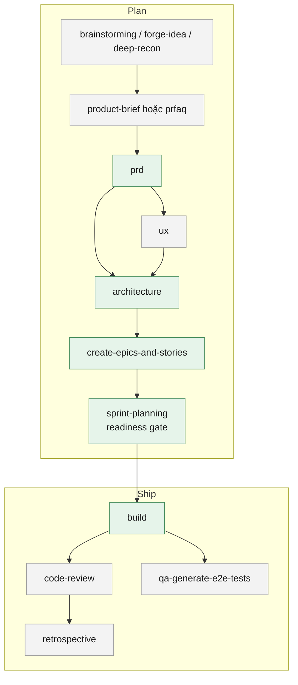

# BMAD Method: kiến trúc và workflow

> Mới dùng lần đầu? Đọc [hướng dẫn nhập môn](./bmad-method-onboarding.md) trước; tài liệu này dùng để tra cứu. Phân vân giữa BMAD và bộ Matt Pocock? Xem [so sánh](../../docs/so-sanh-voi-matt-pocock.md).

Tài liệu này mô tả [BMAD Method](https://github.com/bmad-code-org/BMAD-METHOD) (tài liệu chính thức: <https://docs.bmad-method.org/>): bộ cài gồm những gì, các skill nối với nhau ra sao, dùng từng skill khi nào. Nội dung được rút ra từ chính các file `SKILL.md`, `customize.toml` và `_bmad/_config/bmad-help.csv` trong repo này.

**Phiên bản mô tả:** 6.12.4, cài ngày 2026-11-05. Những gì đổi so với bản trước nằm ở [mục 8](#8-nhật-ký-cập-nhật).

Thuật ngữ gốc (party mode, memlog, spine, headless, Fast path…) được giữ nguyên tiếng Anh vì các skill dùng chính những từ này để điều khiển hành vi của agent.

---

## 1. Tóm tắt

- **29 skill** trong 2 module: `core` (8 skill dùng chung, không gắn với phát triển phần mềm) và `bmm` (BMad Method, 21 skill cho vòng đời phát triển sản phẩm, gồm cả 5 agent).
- **5 agent có persona**: Mary (Analyst), John (PM), Sally (UX), Winston (Architect), Amelia (Dev). Mỗi agent là một skill `bmad-agent-*`: nó nhập vai, chào, rồi đưa ra **menu** các skill thuộc vai đó. Không có Scrum Master, QA hay PO riêng trong bản này.
- Vòng đời đi theo 3 phase trong `bmad-help.csv`: **plan** (ý tưởng, brief, PRD, UX, kiến trúc, epic/story, sprint) → **ship** (build, review, test, retro), cộng các skill **anytime** dùng lúc nào cũng được (party mode, forge idea, review, research…).
- Không nhớ dùng skill nào thì gọi **`bmad-help`**: skill router, đọc trạng thái dự án (file đầu ra đã có) và gợi ý bước tiếp.
- Hầu hết skill chạy script Python qua **`uv`**. `bmad-build` và `bmad-build-auto` **dừng hẳn** nếu máy không có `uv`; các skill khác tự đọc file cấu hình khi script lỗi.

### Tra nhanh: tôi muốn… → dùng skill nào

| Tình huống | Skill |
|---|---|
| Không biết bắt đầu từ đâu, hoặc bước tiếp theo là gì | `bmad-help` |
| Sinh thật nhiều ý tưởng cho một chủ đề | `bmad-brainstorming` |
| Có ý tưởng nửa vời, muốn bị hỏi vặn đến khi chắc chắn (hoặc bỏ) | `bmad-forge-idea` |
| Muốn nhiều "chuyên gia" cùng tranh luận về một ý tưởng | `bmad-party-mode` |
| Ép một bản nháp vừa viết phải tốt hơn (pre-mortem, red team, first principles…) | `bmad-advanced-elicitation` |
| Nghiên cứu thị trường, domain, công nghệ, đối thủ, chọn giữa các phương án | `bmad-deep-recon` |
| Viết product brief 1–2 trang | `bmad-product-brief` |
| Thử ý tưởng sản phẩm bằng Working Backwards (viết thông cáo báo chí trước) | `bmad-prfaq` |
| Viết, sửa hoặc thẩm định PRD | `bmad-prd` |
| Đặc tả UX: giao diện (`DESIGN.md`) và hành vi (`EXPERIENCE.md`) | `bmad-ux` |
| Chốt các quyết định kiến trúc giữ cho các phần làm riêng không lệch nhau | `bmad-architecture` |
| Gom mọi đầu vào thành một spec ngắn (`SPEC.md`), có thể tách story | `bmad-spec` |
| Chia PRD và kiến trúc thành epic và user story có AC | `bmad-create-epics-and-stories` |
| Kiểm tra kế hoạch đủ để code chưa, tạo file theo dõi sprint, xem tiến độ | `bmad-sprint-planning` |
| Code một tính năng, story hoặc bug fix, có review và commit | `bmad-build` |
| Một vòng code tự động không cần người (chạy trong vòng lặp) | `bmad-build-auto` |
| Review code bằng nhiều reviewer song song | `bmad-code-review` |
| Review bất kỳ thứ gì (code hoặc tài liệu) theo các "lens" | `bmad-review` |
| Dẫn người review đi qua một thay đổi | `bmad-walkthrough` |
| Sinh test API và E2E cho tính năng đã làm | `bmad-qa-generate-e2e-tests` |
| Giữa sprint có thay đổi lớn, cần đánh giá ảnh hưởng | `bmad-correct-course` |
| Nhìn lại một epic đã xong | `bmad-retrospective` |
| Viết hoặc làm mới chỉ dẫn cho agent (`AGENTS.md`) của một repo | `bmad-project-context` |
| Đổi hành vi một agent hoặc skill (thêm fact, đổi template, thêm bước) | `bmad-customize` |

---

## 2. Kiến trúc

### 2.1. Cấu trúc sau khi cài

Cài bằng `npx bmad-method install` (cần Node.js). Bộ cài hỏi module, công cụ AI (IDE) và vài câu cấu hình, rồi sinh ra:

```text
<repo>/
├── _bmad/                              ← lõi của bộ cài
│   ├── config.toml                     ← cấu hình chung + persona của 5 agent (do bộ cài sinh, đừng sửa tay)
│   ├── config.user.toml                ← câu trả lời cá nhân lúc cài (tên, ngôn ngữ)
│   ├── custom/                         ← nơi duy nhất nên sửa: override cho team và cá nhân
│   ├── scripts/                        ← script Python dùng chung: resolve_config, resolve_customization, memlog, render_skill
│   ├── _config/                        ← manifest.yaml (phiên bản), bmad-help.csv (bản đồ flow), skill-manifest.csv, files-manifest.csv (hash)
│   └── core/, bmm/                     ← config.yaml, module-help.csv, v6-shims/ của từng module
├── .agents/skills/bmad-*/              ← skill (đích Antigravity; công cụ khác đọc chuẩn .agents/skills cũng thấy)
├── .claude/skills/bmad-*/              ← bản chép cho Claude Code
├── .kiro/skills/bmad-*/                ← bản chép cho Kiro
└── _bmad-output/                       ← mọi đầu ra của skill (xem mục 6)
```

Mỗi skill có `SKILL.md` (quy trình) và `customize.toml` (các giá trị chỉnh được). Skill dài tách sang `references/`, `steps/`, `assets/`, `scripts/` và chỉ đọc khi cần.

`bmad-build` và `bmad-build-auto` khác các skill còn lại: `SKILL.md` chỉ có một lệnh `uv run _bmad/scripts/render_skill.py`. Script này ghép `customize.toml` vào workflow rồi in ra đường dẫn một bản "snapshot" để agent đọc. Không có `uv` thì skill dừng.

### 2.2. Cấu hình bốn lớp

Mọi skill gọi `resolve_config.py`, script này gộp theo thứ tự (lớp sau thắng):

1. `_bmad/config.toml`: do bộ cài sinh.
2. `_bmad/config.user.toml`: câu trả lời cá nhân lúc cài.
3. `_bmad/custom/config.toml`: override của team, commit vào repo.
4. `_bmad/custom/config.user.toml`: override cá nhân, không commit.

Các giá trị quan trọng:

| Khoá | Ý nghĩa | Mặc định |
|---|---|---|
| `user_name` | Tên agent dùng để chào | Hỏi lúc cài |
| `communication_language` | Ngôn ngữ nói chuyện | Hỏi lúc cài |
| `document_output_language` | Ngôn ngữ viết tài liệu đầu ra | Hỏi lúc cài |
| `output_folder` | Thư mục đầu ra | `_bmad-output` |
| `planning_artifacts` | Đầu ra phase plan | `_bmad-output/planning-artifacts` |
| `implementation_artifacts` | Đầu ra phase ship | `_bmad-output/implementation-artifacts` |
| `project_knowledge` | Tài liệu dự án sẵn có để agent đọc thêm | `docs` |
| `user_skill_level` | Mức kinh nghiệm, ảnh hưởng cách giải thích | `intermediate` |

Riêng từng skill có `customize.toml`. Override đặt ở `_bmad/custom/<tên-skill>.toml` (team) và `_bmad/custom/<tên-skill>.user.toml` (cá nhân). Quy tắc gộp: giá trị đơn thì override thắng, bảng thì gộp sâu, mảng bảng có `code`/`id` thì thay mục trùng khoá, mảng thường thì nối thêm. Các điểm chỉnh thường dùng:

- `persistent_facts`: câu hoặc file (`file:...`) agent luôn nhớ trong phiên, ví dụ quy định công ty.
- `activation_steps_prepend` / `activation_steps_append`: bước chạy thêm trước hoặc sau khi khởi động.
- `on_complete`: việc làm khi skill kết thúc.
- `external_sources`, `external_handoffs`: nguồn tri thức nội bộ (MCP) và nơi đẩy tài liệu đi (Confluence, Notion…).
- `doc_standards`, `finalize_reviewers`: chuẩn đánh bóng và các reviewer chạy trước khi chốt tài liệu.

Không muốn tự viết TOML thì gọi `bmad-customize`: nó tìm điểm chỉnh phù hợp, ghi file override và kiểm tra kết quả gộp.

### 2.3. Agent: persona + menu

Mỗi `bmad-agent-*` làm 8 bước: gộp cấu hình agent, chạy bước bổ sung, nhập vai, nạp fact, nạp config, chào (có icon đầu mỗi tin), chạy bước bổ sung sau chào, rồi đưa **menu**. Persona giữ nguyên cho đến khi người dùng cho thôi, kể cả khi đang chạy skill khác.

| Agent | Vai | Menu (mã → skill) |
|---|---|---|
| 📊 Mary, `bmad-agent-analyst` | Business Analyst | BP brainstorming · MR/DR/TR/CR/UV research thị trường, domain, kỹ thuật, đối thủ, tiếng nói người dùng (`bmad-deep-recon`) · TS chọn công nghệ/nhà cung cấp · CB product brief · WB PRFAQ · PC project context |
| 📋 John, `bmad-agent-pm` | Product Manager | PRD · CE epic và story · IR kiểm tra sẵn sàng code (`bmad-sprint-planning`) · CC correct course |
| 🎨 Sally, `bmad-agent-ux-designer` | UX Designer | CU tạo UX (`bmad-ux`) |
| 🏗️ Winston, `bmad-agent-architect` | System Architect | CA architecture spine · IR kiểm tra sẵn sàng code |
| 💻 Amelia, `bmad-agent-dev` | Senior Software Engineer | BD build · QA test E2E · CR code review · SP sprint plan · ER retrospective |

Agent chỉ là lớp vỏ: gọi thẳng skill (ví dụ `bmad-prd`) cũng chạy đúng quy trình đó, chỉ không có persona. Persona đáng giá nhất khi dùng trong `bmad-party-mode` và `bmad-forge-idea`, nơi nhiều giọng cùng phản biện.

### 2.4. Memlog: trạng thái bền và tiếp tục phiên

Các skill tạo tài liệu (brief, PRD, UX, architecture, spec, forge, brainstorming, party mode) đều ghi một file **`.memlog.md`** trong thư mục chạy:

- Mỗi quyết định, giả định, thay đổi, câu hỏi mở là **một dòng, chỉ nối thêm**, ghi qua `memlog.py` (không sửa tay).
- Tài liệu chính (`prd.md`, `SPEC.md`, `ARCHITECTURE-SPINE.md`…) được **chưng cất từ memlog** ở bước Finalize. Cái gì không có trong memlog thì mất khi tiếp tục phiên.
- Gọi lại skill sẽ thấy phiên dở dang (frontmatter `status` khác `final`/`complete`) và đề nghị tiếp tục.
- `addendum.md` giữ phần chi tiết người dùng đưa ra nhưng thuộc tài liệu sau (lựa chọn đã loại, chi tiết kỹ thuật, persona sâu…), để PRD không phình.

Riêng `bmad-spec`: `SPEC.md` **luôn được sinh lại** từ memlog; sửa tay `SPEC.md` sẽ bị ghi đè.

### 2.5. Các nguyên lý xuyên suốt

- **Coaching path và Fast path.** Brief, PRD, UX, architecture đều hỏi cách làm. Coaching: agent hỏi, đẩy ngược, để người dùng tự nghĩ (mặc định của architecture). Fast: agent gom câu hỏi còn thiếu thành 1–2 lượt rồi viết nháp, gắn `[ASSUMPTION]` chỗ tự suy.
- **Khai thác, không áp đặt.** Các skill PRD, UX được dặn "fight the urge to do the thinking for them": không tự đề xuất MVP, màu sắc, phase; nếu thấy mình đang làm thế thì "trả bút lại".
- **Định cỡ theo mức rủi ro.** Hỏi trước "dự án cá nhân / nội bộ / ra mắt" để chọn độ dài: PRD cá nhân khoảng 2 trang, công cụ nội bộ 5–8 trang.
- **Subagent làm việc nặng.** Đọc tài liệu đầu vào lớn, tra web, review đều giao cho subagent; agent chính chỉ nhận bản tóm. Công cụ không có subagent thì chạy tuần tự.
- **Reviewer Gate trước khi chốt.** PRD, UX, architecture chạy rubric và các reviewer song song, mỗi reviewer ghi `review-*.md`. Với UX, gate là tuỳ chọn vì tốn token.
- **Headless.** Hầu hết skill có chế độ không hỏi (`-H` / `--headless`): tự làm từ đầu vào có sẵn, trả JSON, thiếu thông tin thì dừng với `blocked`. Dùng khi skill khác hoặc vòng lặp tự động gọi.
- **Mỗi skill một context mới.** `bmad-help` dặn chạy mỗi skill trong cửa sổ context mới.

### 2.6. Skill cũ (v6 shims)

Các tên skill cũ (`bmad-create-prd`, `bmad-quick-dev`, `bmad-dev-story`, `bmad-create-story`…) nằm ở `_bmad/*/v6-shims/`, chuyển tiếp sang skill mới. Bản cài này đặt `installShims: false` nên chúng **không** được cài. Tài liệu và bài viết cũ nhắc các tên đó thì tra bảng trong `_bmad/bmm/v6-shims/README.md`.

---

## 3. Flow chuẩn: từ ý tưởng đến code

Lấy từ cột `phase`, `preceded-by`, `required` của `bmad-help.csv`. Bước **bắt buộc** (required) là bước phải xong mới sang phase sau có nghĩa.



Bất kỳ lúc nào: `party-mode`, `advanced-elicitation`, `forge-idea`, `deep-recon`, `review`, `spec`, `project-context`, `correct-course`, `sprint-planning` (xem tiến độ), `walkthrough`, `help`, `customize`.

**Đường tắt.** Không phải việc nào cũng đi đủ flow:

- Việc nhỏ hoặc bug: gọi thẳng `bmad-build`. Bước 2 của nó tự chọn **oneshot** (ghi ý định, code, review, commit) khi việc nhỏ và không có gì mơ hồ.
- Có tài liệu sẵn (brief, PRD của người khác, biên bản họp): `bmad-spec` chưng cất thành `SPEC.md`, rồi tách story (`stories.yaml`) và đưa cho `bmad-build`.
- `bmad-forge-idea` có thể giao `forged-idea.md` thẳng cho `bmad-spec` hoặc `bmad-build`.

---

## 4. Các skill theo nhóm

### 4.1. Ý tưởng và phản biện (anytime)

| Skill | Làm gì | Đầu ra |
|---|---|---|
| `bmad-brainstorming` | Phiên sinh ý tưởng, nhắm hơn 100 ý. 3 tư thế: **Facilitator** (agent không góp ý tưởng), **Creative Partner** (cùng góp), **Ideate for me** (agent tự làm). Chọn kỹ thuật trên trang HTML `brain-selector.html` hoặc trong chat; đổi kỹ thuật mỗi 5–10 lượt; có pha hội tụ riêng. | `{output_folder}/brainstorming/brainstorm-<chủ đề>-<ngày>/` |
| `bmad-forge-idea` | Hỏi vặn một ý tưởng nửa vời, **mỗi lần một câu**, theo thứ tự phụ thuộc. Mỗi lượt có 2 giọng: một agent/persona có sẵn hợp chủ đề và một giọng "người ngoài" sinh mới (đối thủ, người mua, tài chính…). Người dùng nói "attack this", "defend this", "switch roles" để đổi thế. Kết thúc ở 1 trong 3 trạng thái: **Hardened**, **Killed**, **Clearer**. | `{output_folder}/forge/<slug>/`: memlog, `forged-idea.md` (nếu Hardened), `forge-report.html` |
| `bmad-party-mode` | Bàn tròn nhiều persona nói chuyện với nhau và với người dùng. Chi tiết ở [mục 5](#5-party-mode). | Tuỳ chọn: HTML kỷ niệm trong `{output_folder}/party-mode/`; memlog nếu bật memory |
| `bmad-advanced-elicitation` | Áp một phương pháp phản biện lên **bản vừa viết** (một mục PRD, một quyết định…). Đưa menu 5 phương pháp (pre-mortem, first principles, red team, socratic…), chọn, xem đề xuất, Apply hoặc Reject. Skill khác gọi nó ở các điểm dừng. | Bản đã sửa, trả về skill gọi |
| `bmad-deep-recon` | Nghiên cứu phục vụ một quyết định, 3 cách: viết prompt để người dùng chạy ở ChatGPT/Gemini/Perplexity…; tóm báo cáo nghiên cứu có sẵn thành bản có trích nguồn; hoặc tự tra web song song. Loại: market, domain, technical, competitive, user-voice, academic-lit, chọn giữa các phương án. | `{planning_artifacts}/research/<loại>-<chủ đề>-<ngày>/` |

### 4.2. Định hình sản phẩm (phase plan)

| Skill | Làm gì | Đầu ra |
|---|---|---|
| `bmad-product-brief` | Brief 1–2 trang qua hội thoại. Bắt đầu bằng "brain dump" và xin tài liệu sẵn có, hỏi mức rủi ro, rồi chọn Fast hoặc Coaching. Tạo, cập nhật hoặc thẩm định brief. | `{planning_artifacts}/briefs/brief-<dự án>-<ngày>/brief.md`, `addendum.md`, `.memlog.md` |
| `bmad-prfaq` | Working Backwards của Amazon: 5 chặng (Ignition → Press Release → Customer FAQ → Internal FAQ → Verdict). Giọng "hardcore", ép bắt đầu từ khách hàng và vấn đề, không từ giải pháp hay công nghệ. Là lựa chọn thay cho brief. | `{planning_artifacts}/prfaq-<dự án>.md` kèm bản chưng cất cho PRD |
| `bmad-prd` | Tạo, cập nhật, thẩm định PRD. Brain dump → mức rủi ro → chọn Fast/Coaching (Coaching có 2 lối: Vision + Features hoặc Journey-led). FR đánh số ổn định, NFR riêng, không có ma trận traceability, chi tiết kỹ thuật đẩy sang addendum. Finalize: rà memlog, đối chiếu đầu vào, Reviewer Gate, xử lý câu hỏi mở, đánh bóng. | `{planning_artifacts}/prds/prd-<dự án>-<ngày>/prd.md`, `addendum.md`, `review-*.md` |
| `bmad-ux` | Hai tài liệu ngang hàng: `DESIGN.md` (nhìn thế nào, theo chuẩn Google Labs `design.md`) và `EXPERIENCE.md` (IA, trạng thái, tương tác, accessibility, journey). Có công cụ trực quan (theme HTML, wireframe Excalidraw, mock màn hình chính) và chế độ giao cho công cụ thiết kế ngoài (mặc định Google Stitch). | `{planning_artifacts}/ux-designs/ux-<dự án>-<ngày>/` |

### 4.3. Kiến trúc và chia việc (phase plan)

| Skill | Làm gì | Đầu ra |
|---|---|---|
| `bmad-architecture` | Viết **architecture spine**: chỉ các *bất biến* giữ cho những phần làm độc lập không lệch nhau (paradigm, ranh giới, luật phụ thuộc, ai sở hữu dữ liệu chung). Phép thử: "hai nhóm làm riêng có thể chọn khác nhau không? Có, không hiển nhiên, và là đánh đổi thật thì mới ghi". Mỗi quyết định là một `AD-n` (Binds / Prevents / Rule). Mặc định Coaching. Dự án có sẵn: đọc code để xác nhận quy ước đang có. | `{planning_artifacts}/architecture/architecture-<dự án>-<ngày>/ARCHITECTURE-SPINE.md` |
| `bmad-spec` | Chưng cất mọi đầu vào (ý tưởng, brief, PRD, transcript, email…) thành `SPEC.md` 5 trường: Why, Capabilities (`CAP-n`), Constraints, Non-goals, Success signal; phần không vừa đưa sang file đi kèm. Có 8 luật (Spec Law). Có thể tách story thành `stories.yaml` cho `bmad-build`. | `{output_folder}/specs/spec-<slug>/` |
| `bmad-create-epics-and-stories` | Chia PRD + kiến trúc thành epic và user story có AC. Chạy theo kiểu **step-file**: mỗi bước một file, không được nhảy bước, dừng ở menu chờ người chọn. | `{planning_artifacts}` |
| `bmad-sprint-planning` | 5 ý định: **readiness** (cổng PASS/CONCERNS/FAIL: kế hoạch đủ để code chưa), **sprint-planning** (qua cổng rồi sinh `sprint-status.yaml` bằng script), **status** (tiến độ, rủi ro, việc tiếp), **validate**, **fix**. | `{implementation_artifacts}/sprint-status.yaml` |
| `bmad-correct-course` | Giữa sprint có thay đổi lớn: đánh giá ảnh hưởng lên PRD, epic, kiến trúc, UX và đề xuất thay đổi (có thể khuyên làm lại từ đầu). | Sprint change proposal |

### 4.4. Code và kiểm tra (phase ship)

| Skill | Làm gì | Đầu ra |
|---|---|---|
| `bmad-build` | 5 bước: **clarify & route** (đọc trạng thái, kiểm tra cây git sạch và nhánh hợp lý, tách việc nhiều mục tiêu) → **plan** (viết spec 900–1600 token; việc nhỏ thì đi đường oneshot) → **CHECKPOINT 1**: người duyệt spec, phần ý định bị khoá → **implement** (ghi `baseline_commit`, không push) → **review** (3 lớp song song: Blind Hunter, Edge Case Hunter, Verification Gap; tự phân loại high/medium/low/false; sửa ngay, hỏi người, hoặc ghi vào `deferred-work.md`) → **present** (commit cục bộ, không bao giờ tự push). Nếu là story của epic: tự biên dịch `epic-N-context.md` và cập nhật `sprint-status.yaml`. | `{implementation_artifacts}/spec-<slug>.md`, `deferred-work.md`, commit cục bộ |
| `bmad-build-auto` | Một vòng của `bmad-build` **không cần người**: dừng thì ghi trạng thái và lý do vào spec của story. Dùng trong vòng lặp tự động. | Như trên |
| `bmad-code-review` | Review thay đổi bằng nhiều reviewer độc lập song song rồi phân loại. Chạy theo step-file. Là bước kiểm thêm sau review có sẵn trong `bmad-build`. | Báo cáo trong chat |
| `bmad-review` | Review bất kỳ nội dung nào theo **lens**: `adversarial` (bắt buộc tìm ít nhất 10 vấn đề), `edge-case-hunter`, `verification-gap`, `structure`, `prose`. Chỉ chạy khi người dùng thật sự nói "review". Đầu ra là mảng JSON thống nhất, không xếp hạng mức độ. | Chat, hoặc file nếu đặt `report_path` |
| `bmad-walkthrough` | Dẫn người review đi qua một thay đổi: để làm gì, chỗ nào cần soi, test thế nào. | Chat |
| `bmad-qa-generate-e2e-tests` | Sinh test API và E2E tự động cho tính năng đã làm. Không dùng để review code. | Bộ test |
| `bmad-retrospective` | Nhìn lại một epic dựa trên bằng chứng (spec, story, diff, commit, sprint status): phát hiện có nguồn, việc cần làm, quyết định nghiệm thu. | Báo cáo retro |

### 4.5. Môi trường cho agent

| Skill | Làm gì | Đầu ra |
|---|---|---|
| `bmad-project-context` | Viết, tiếp nhận, làm mới hoặc kiểm tra **khối chỉ dẫn có quản lý** trong `AGENTS.md`: lệnh đã kiểm chứng, quy định, quy ước khác mặc định, lỗi agent hay mắc (pitfall). Phỏng vấn tối đa 8 câu mỗi lượt, chỉ hỏi cái không quét được. Có "sổ cái" để không xoá mất chỉ dẫn cũ. Ý định `record` ghi một lỗi agent vừa mắc. Không bao giờ commit. | Khối giữa marker trong `AGENTS.md` |
| `bmad-customize` | Viết override cho agent và skill vào `_bmad/custom/`. | File TOML |
| `bmad-help` | Router: đọc `bmad-help.csv`, cấu hình, các file đầu ra đã có, rồi nói đang ở đâu và bước tiếp là gì. | Chat |

---

## 5. Party mode

`bmad-party-mode` dựng một "bàn tròn": các persona nói chuyện như người thật, tranh luận với nhau và kéo người dùng vào cuộc. Skill được dặn rõ: lượt nói ngắn, mỗi giọng có cá tính riêng, **để bất đồng tồn tại thay vì vội hoà giải**, không tự tóm tắt hay rút "takeaways" khi người dùng chưa hỏi.

**Ai ngồi trong phòng.**

- Mặc định: 5 agent đã cài.
- Gọi tên trực tiếp trong câu lệnh ("party mode với Winston và Sally") thì chỉ những người đó vào phòng.
- `--party <id>` chọn một nhóm có sẵn. Bản này kèm 2 nhóm và 9 persona dựng sẵn:
  - **`code-review-crew`**: Vex (bảo mật), Grumbal (kẻ đối nghịch), Boundary (săn edge case), Yui (sự gọn gàng), Dana (thực dụng, "ship 80%").
  - **`anti-consensus-club`**: Wildcard (sinh phương án), Level (kiểm bằng chứng), Killjoy (dừng vòng lặp), Splinter (thách thức đồng thuận dễ dãi). Nhóm này không bỏ phiếu, không tuyên bố đồng thuận, chỉ hỗ trợ người quyết.
- Tự định nghĩa persona và nhóm (có `scene` mô tả bối cảnh) trong override của `bmad-party-mode`, hoặc nhờ chính skill tạo giúp.

**Bốn chế độ chạy** (`--mode`):

| Chế độ | Cách chạy | Khi nào |
|---|---|---|
| `session` (mặc định) | **Một model** nói thay mọi persona | Trao đổi nhanh, rẻ |
| `auto` | Nói thay là chính, chỉ tách subagent khi cần suy nghĩ độc lập | Cân bằng |
| `subagent` | Mỗi persona là một subagent riêng ở mỗi lượt quan trọng | Khi cần phản biện **độc lập thật**, tránh mọi giọng cùng một suy nghĩ |
| `agent-team` | Đội agent tồn tại suốt phiên, nói chuyện trực tiếp với nhau | Chỉ Claude Code |

Công cụ không hỗ trợ chế độ đã chọn thì tự lùi về `session`.

**Kết thúc.** Party chạy đến khi người dùng muốn dừng. Lúc đó agent đọc lại những ý đáng giá nhất, cập nhật memlog nếu bật memory (phòng mặc định bật sẵn `party_memory = true`) và đề nghị xuất một file HTML kỷ niệm. Party **không** tự sinh PRD hay brief; muốn thành tài liệu thì đưa kết quả sang `bmad-prd`, `bmad-product-brief` hoặc `bmad-forge-idea`.

**Gọi party từ bên trong skill khác.** Brief, PRD, UX, spec, brainstorming đều nhắc ngay lúc chào rằng có thể gọi `bmad-party-mode` hoặc `bmad-advanced-elicitation` bất cứ lúc nào. `bmad-build` gợi ý dùng party mode để soi spec trước khi duyệt, "tốt nhất ở phiên khác để đỡ phình context".

---

## 6. Đầu ra nằm ở đâu

| Đường dẫn (mặc định) | Skill ghi |
|---|---|
| `_bmad-output/brainstorming/` | brainstorming |
| `_bmad-output/forge/` | forge-idea |
| `_bmad-output/party-mode/` (`memories/` bên trong) | party-mode |
| `_bmad-output/specs/` | spec |
| `_bmad-output/planning-artifacts/research/` | deep-recon |
| `_bmad-output/planning-artifacts/briefs/` | product-brief |
| `_bmad-output/planning-artifacts/prfaq-<dự án>.md` | prfaq |
| `_bmad-output/planning-artifacts/prds/` | prd |
| `_bmad-output/planning-artifacts/ux-designs/` | ux |
| `_bmad-output/planning-artifacts/architecture/` | architecture |
| `_bmad-output/planning-artifacts/` (epic) | create-epics-and-stories |
| `_bmad-output/implementation-artifacts/` | sprint-planning, build, qa, retrospective |
| `AGENTS.md` (khối có marker) | project-context |
| `_bmad/custom/` | customize |

Đổi chỗ bằng override `output_folder`, `planning_artifacts`, `implementation_artifacts` hoặc khoá `*_output_path` trong `customize.toml` của từng skill.

---

## 7. Chạy trên các công cụ

| Công cụ | Bộ cài hỗ trợ | Ghi chú |
|---|---|---|
| Claude Code | Có (`claude-code` → `.claude/skills/`) | Đủ tính năng: subagent, `agent-team` của party mode |
| Antigravity | Có (`antigravity-cli` → `.agents/skills/`) | Subagent tuỳ phiên bản; chưa kiểm chứng |
| Kiro | Có (`kiro` → `.kiro/skills/`) | Chưa kiểm chứng |
| GitHub Copilot | Không có trong danh sách đã chọn lúc cài bản này | Copilot đọc được skill trong `.agents/skills/` thì thấy bộ BMAD; mã nguồn `bmad-build` ghi rõ Copilot không có subagent nên chạy tuần tự. Chưa kiểm chứng |

Điều kiện chung cho mọi công cụ: máy có **`uv`** (và Python) để chạy script. Không có `uv`, `bmad-build` và `bmad-build-auto` dừng; các skill khác vẫn chạy nhưng tự đọc cấu hình.

---

## 8. Nhật ký cập nhật

### 2026-11-05: bản đầu, BMAD 6.12.4

- Chép từ bản cài ở `D:\Workspace\Tools` (cài bằng bộ cài chính thức cho `claude-code`, `antigravity-cli`, `kiro`; module `core` + `bmm`; `installShims: false`).
- 29 skill: 8 thuộc `core`, 21 thuộc `bmm` (trong đó có 5 agent).
- Viết tài liệu tham chiếu, onboarding cho PM/Techlead, so sánh với bộ Matt Pocock, case study 01.
