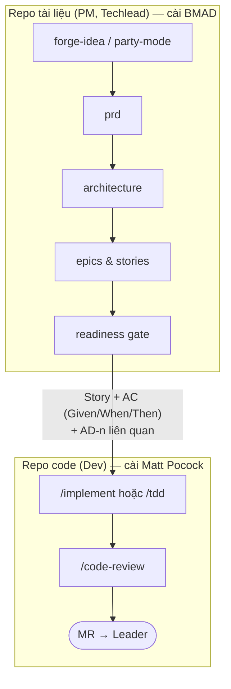

# BMAD Method và bộ Matt Pocock: khi nào dùng cái nào

So sánh [BMAD Method](./bmad-method.md) 6.12.4 với [bộ skill Matt Pocock](../../matt-pocock-skills/docs/matt-pocock-skills.md) (repo nguồn 2026-10-31, commit `4ae2317`). Người đọc chính là PM (Product Manager) và Techlead, có thêm phần trả lời cho dev.

**Cách làm:** đối chiếu mã nguồn `SKILL.md` của hai bộ. **Chưa chạy thử đối chứng** trên cùng một việc; chỗ nào là suy luận hoặc chưa kiểm chứng đều được ghi rõ. Khi có kết quả chạy thật, cập nhật vào case study và sửa tài liệu này.

---

## 1. Tóm tắt một đoạn

**BMAD** là một *phương pháp có sẵn quy trình*: dựng cả đội Agile ảo (Analyst, PM, UX, Architect, Dev), dẫn bạn đi từ ý tưởng → brief → PRD → UX → kiến trúc → epic/story → sprint → code → retro, mỗi bước sinh tài liệu chuẩn. Mạnh nhất ở **phần trước khi code**. **Matt Pocock** là *bộ dụng cụ nhỏ tự ghép*: phỏng vấn làm rõ, spec, ticket, TDD, review, sửa bug khó, cải thiện kiến trúc. Mạnh nhất ở **phần code và giữ codebase tốt cho agent**.

Kết luận ngắn: **PM dùng BMAD. Techlead dùng BMAD cho kiến trúc và chia việc, dùng Matt Pocock cho review và sức khoẻ codebase. Dev mặc định dùng Matt Pocock.** Chi tiết ở [mục 4](#4-nên-dùng-gì-theo-vai-và-loại-việc).

---

## 2. So sánh theo 6 tiêu chí

### 2.1. Phủ những giai đoạn nào

| Giai đoạn | BMAD | Matt Pocock |
|---|---|---|
| Sinh ý tưởng | `bmad-brainstorming` (hơn 100 ý, nhiều kỹ thuật) | Không có |
| Phản biện ý tưởng | `bmad-forge-idea`, `bmad-party-mode`, `bmad-advanced-elicitation` | `/grilling` (`/grill-me`, `/grill-with-docs`) |
| Nghiên cứu thị trường, đối thủ, domain | `bmad-deep-recon` | `/research` (tra tài liệu gốc, thiên về kỹ thuật) |
| Brief, PRFAQ, PRD | `bmad-product-brief`, `bmad-prfaq`, `bmad-prd` | Không có; gần nhất là `/to-spec` |
| UX | `bmad-ux` (`DESIGN.md`, `EXPERIENCE.md`, wireframe, mock) | `/prototype` (code thử để trả lời một câu hỏi UI) |
| Kiến trúc | `bmad-architecture` (spine, `AD-n`) | `/codebase-design` (deep module, seam), ADR qua `/domain-modeling` |
| Ngôn ngữ nghiệp vụ | Không có skill riêng | `/domain-modeling` (`GLOSSARY.md`, ADR) |
| Chia việc | `bmad-create-epics-and-stories`, `bmad-spec` → `stories.yaml` | `/to-tickets` (tracer bullet, có cạnh chặn) |
| Kiểm tra sẵn sàng, theo dõi sprint | `bmad-sprint-planning` (PASS/CONCERNS/FAIL, `sprint-status.yaml`) | Không có |
| Code | `bmad-build` (spec → duyệt → code → review 3 lớp → commit) | `/implement`, `/implement-spec`, `/tdd` |
| Bug khó | Không có skill riêng (dùng `bmad-build`) | `/diagnosing-bugs` (vòng phản hồi chặt, test hồi quy) |
| Bug và yêu cầu dồn đống | Không có | `/triage` |
| Review | `bmad-code-review`, `bmad-review` (lens), `bmad-walkthrough` | `/code-review` (2 trục: Standards + Spec) |
| Test E2E | `bmad-qa-generate-e2e-tests` | Không có |
| Thay đổi giữa chừng | `bmad-correct-course` | Không có |
| Nhìn lại | `bmad-retrospective` (theo epic, nghiệm thu) | `/retro` (theo phiên, cải thiện môi trường agent) |
| Việc quá lớn, còn mù mờ | Đi đủ flow plan | `/wayfinder` (bản đồ ticket quyết định) |
| Chỉ dẫn cho agent | `bmad-project-context` (khối trong `AGENTS.md`) | `/writing-for-agents`, `/retro`, `/setup-matt-pocock-skills` |
| Bàn giao phiên | memlog + tiếp tục phiên | `/handoff` |

### 2.2. Triết lý

| | BMAD | Matt Pocock |
|---|---|---|
| Đơn vị | **Vai + quy trình**: agent có tên, tính cách, menu; workflow nhiều bước, có bước theo kiểu step-file không được nhảy | **Skill nhỏ ghép được**: primitive (`grilling`, `tdd`, `code-review`) + flow ghép primitive; skill tên quen nhất chỉ là wrapper một dòng |
| Ai nghĩ | Agent huấn luyện, hỏi ngược, "không nghĩ thay"; có Fast path khi cần nhanh | Agent phỏng vấn theo vòng, "fact là việc của agent, quyết định là của người" |
| Trạng thái | Memlog nối thêm cho mỗi phiên, tài liệu chưng cất từ memlog, tiếp tục phiên tự động | File Markdown thường (spec, ticket, `GLOSSARY.md`, ADR), giữ context trong một cửa sổ, `/handoff` khi chuyển |
| Tuỳ biến | Hệ override TOML 4 lớp, `persistent_facts`, hook trước và sau, `bmad-customize` | Sửa thẳng file trong repo (`CLAUDE.md`, `docs/agents/`), coding standards cho `/code-review` |
| Phụ thuộc | Node (bộ cài) + **`uv`/Python** lúc chạy | Node (`npx skills`) lúc cài; lúc chạy chủ yếu là Markdown |
| Độ "nặng" | Nặng: nhiều subagent, Reviewer Gate, tài liệu dài theo mức rủi ro | Nhẹ: một việc một skill, đi thẳng |

### 2.3. Sinh ra tài liệu gì, nằm ở đâu

| | BMAD | Matt Pocock |
|---|---|---|
| Thư mục | Tất cả trong `_bmad-output/` (đổi được) | Rải theo cấu hình: `.scratch/<feature>/` hoặc issue tracker thật, `GLOSSARY.md`, `docs/adr/` |
| Trước khi code | brief, PRFAQ, `prd.md` + `addendum.md`, `DESIGN.md`/`EXPERIENCE.md`, `ARCHITECTURE-SPINE.md`, epic/story, `SPEC.md`, báo cáo research, `forge-report.html` | Spec, ticket có cạnh chặn, glossary, ADR, nhánh `prototype/<tên>` |
| Khi code | `spec-<slug>.md` cho mỗi việc, `sprint-status.yaml`, `deferred-work.md`, `epic-N-context.md`, commit cục bộ | Commit, mô tả PR (`/pr`) |
| Người đọc | PM, stakeholder, team (tài liệu dạng văn bản sản phẩm) | Dev và agent (tài liệu dạng làm việc) |

### 2.4. Công sức, thời gian, token

| Việc | BMAD | Matt Pocock |
|---|---|---|
| Sửa một bug nhỏ | `bmad-build` tự chọn đường **oneshot** (ghi ý định, code, 1 lớp review, commit). Vẫn có kiểm tra cây git, tách việc nhiều mục tiêu | `/implement` hoặc `/tdd` trực tiếp, nhẹ hơn |
| Một tính năng vừa | `bmad-build` đủ 5 bước: spec 900–1600 token, chờ duyệt, code, 3 reviewer song song | `/grill-with-docs` → `/implement` (+ `/code-review`) |
| Sản phẩm mới | Đủ flow plan: nhiều phiên, nhiều tài liệu, nhiều subagent (research, review). **Tốn nhất**, nhưng ra bộ tài liệu đầy đủ | `/grill-with-docs` → `/to-spec` → `/to-tickets` → `/implement-spec`. Ít tài liệu sản phẩm hơn |
| Phản biện ý tưởng | `party-mode` mặc định chạy một model (rẻ); `--mode subagent` tốn hơn nhiều | `/grill-me` một model |

Ước lượng trên dựa vào số bước và số subagent trong mã nguồn, **chưa đo token thật**.

### 2.5. Có khớp với Agile Scrum không

Quy trình chuẩn của tài liệu này là **Agile Scrum**: backlog và sprint quản lý trên tracker của team; Techlead làm rõ requirement với customer và BA; story có AC; dev tạo MR, Techlead review.

Cả hai bộ đều **không quản lý nhịp sprint**: không có sprint có thời hạn, ước lượng, velocity hay Scrum Master. Chúng là công cụ cho từng hoạt động trong sprint. Bảng đối chiếu từng hoạt động của BMAD nằm ở [mục 6 của onboarding](./bmad-method-onboarding.md#6-bmad-trong-agile-scrum).

| Hoạt động Scrum | BMAD | Matt Pocock |
|---|---|---|
| Nhận requirement từ customer/BA vào backlog | **Mạnh**: `bmad-spec` gom biên bản, email, BRD thành spec kèm câu hỏi mở; `bmad-prd` viết hoặc thẩm định tài liệu yêu cầu | `/to-questionnaire` soạn câu hỏi gửi customer/BA; `/domain-modeling` dựng glossary thuật ngữ nghiệp vụ |
| Backlog Refinement | **Mạnh**: `forge-idea`, `party-mode` (thêm persona customer, BA, QA), `advanced-elicitation`, `bmad-review` soát AC | `/grilling` phỏng vấn làm rõ |
| Story có AC | **Khớp tốt**: epic/story có AC; spec của `bmad-build` yêu cầu AC dạng Given/When/Then | `/to-tickets` chia ticket có cạnh chặn; ít chú trọng AC hơn |
| Definition of Ready | **Có**: cổng readiness PASS/CONCERNS/FAIL | Không có |
| Sprint Planning, ước lượng | Không có | Không có |
| Theo dõi tiến độ | `sprint-status.yaml` là file riêng, **trùng với tracker**; có thể bỏ qua | `/setup-matt-pocock-skills` trỏ được vào tracker thật hoặc thư mục local |
| Code trong sprint | `bmad-build`; story từ kế hoạch BMAD thì tự nạp epic context | `/implement`, `/tdd`, `/diagnosing-bugs` |
| Không tự push, dev tự tạo MR | **Khớp**: `bmad-build` chỉ commit cục bộ, "NEVER auto-push" | Khớp: không skill nào tự push |
| Review MR, Definition of Done | `bmad-code-review` (3 lớp), `bmad-walkthrough` | `/code-review` (Standards + Spec) |
| Dự án chỉ có unit test hoặc không có test | `bmad-build` vẫn chạy; `bmad-qa-generate-e2e-tests` cần E2E được | `/tdd` cần chạy được test |
| Sprint Retrospective | `bmad-retrospective` theo **epic** | `/retro` theo **phiên làm việc** |
| Đổi scope giữa sprint | `bmad-correct-course` | Không có |
| Máy làm việc | Cần cài `uv` + Python; thiếu thì `bmad-build` dừng | Không cần gì thêm |

### 2.6. Chạy trên Claude Code, Copilot, Antigravity, Kiro

Ngữ cảnh dùng: **Kiro** cho công việc chung trong team; **Claude Code và Antigravity** cho việc cá nhân. Copilot giữ trong bảng để tham khảo.

| Công cụ | BMAD | Matt Pocock |
|---|---|---|
| Claude Code | Có, đủ tính năng (subagent, `agent-team` của party mode) | Có (`npx skills -a claude-code` hoặc plugin) |
| GitHub Copilot | Bộ cài 6.12.4 ở đây không chọn Copilot. Mã nguồn `bmad-build` tính tới Copilot (không có subagent thì chạy tuần tự). **Chưa kiểm chứng** | Có (`npx skills -a github-copilot` hoặc plugin) |
| Antigravity | Có (đích `antigravity-cli` → `.agents/skills/`). **Chưa kiểm chứng** | Đọc `.agents/skills/` thì thấy. **Chưa kiểm chứng** |
| Kiro | Có (đích `kiro` → `.kiro/skills/`). **Chưa kiểm chứng** | **Chưa kiểm chứng** |
| Điều kiện chung | `uv` + Python trên mọi máy | Không |
| Skill chỉ cho một công cụ | `agent-team` (Claude Code) | `git-guardrails-claude-code`, `claude-handoff` |

---

## 3. Điểm mạnh riêng, không bộ nào thay được bộ kia

Đối chiếu theo từng tình huống cụ thể (14 case study của bộ Matt Pocock): xem [case-study-matt-pocock-voi-bmad.md](./case-study-matt-pocock-voi-bmad.md).

**Chỉ BMAD có:**

- Phản biện ý tưởng bằng nhiều persona (`party-mode`, `forge-idea` với giọng "người ngoài"), có kết luận Hardened/Killed.
- Tài liệu sản phẩm đầy đủ: brief, PRFAQ, PRD, UX hai lớp, có reviewer và thẩm định.
- Research thị trường, đối thủ, tiếng nói người dùng.
- Cổng readiness PASS/CONCERNS/FAIL trước khi giao dev; correct course giữa sprint; retro nghiệm thu theo epic.

**Chỉ Matt Pocock có:**

- `/diagnosing-bugs`: kỷ luật sửa bug khó (dựng vòng phản hồi trước khi đoán).
- `/triage` cho bug và yêu cầu dồn đống.
- `/domain-modeling` (glossary, ADR) và `/codebase-design`, `/improve-codebase-architecture`: giữ codebase dễ cho agent làm việc.
- `/wayfinder` cho việc quá lớn còn mù mờ.
- `/handoff`, phase boundaries: kỷ luật quản lý context.

---

## 4. Nên dùng gì, theo vai và loại việc

| Vai | Loại việc | Nên dùng | Ghi chú |
|---|---|---|---|
| PM | Ý tưởng mới, còn mơ hồ | **BMAD**: `bmad-brainstorming` → `bmad-forge-idea` | Matt `/grill-me` cũng được nếu chỉ cần làm rõ, không cần nhiều góc nhìn |
| PM | Phản biện chéo trước khi viết PRD | **BMAD**: `bmad-party-mode --mode subagent` → `bmad-forge-idea` | Xem case study 01 |
| PM | Viết hoặc thẩm định PRD, brief, PRFAQ | **BMAD** | Matt không có skill tương ứng |
| PM | Nghiên cứu thị trường, đối thủ | **BMAD**: `bmad-deep-recon` | |
| PM | Tính năng nhỏ trong sản phẩm đang chạy | **Matt**: `/grill-with-docs` → `/to-spec` | Đủ, nhẹ hơn; dùng BMAD nếu cần PRD chính thức |
| Techlead | Kiến trúc cho sản phẩm hoặc module mới | **BMAD**: `bmad-architecture` | Kết hợp Matt `/domain-modeling` để chốt thuật ngữ và ADR |
| Techlead | Chia việc cho team | **BMAD**: `bmad-create-epics-and-stories` + readiness gate | Matt `/to-tickets` nhẹ hơn, hợp khi không có PRD |
| Techlead | Review MR | **Matt** `/code-review` (theo coding standards + spec); thêm `bmad-walkthrough` khi thay đổi lớn, khó đọc | `bmad-code-review` cũng được, nặng hơn |
| Techlead | Dự án có sẵn, không có tài liệu | **Cả hai**: `bmad-project-context` cho `AGENTS.md`; Matt `/domain-modeling` + `/improve-codebase-architecture` | Xem case study 01 của bộ Matt |
| Techlead | Thay đổi lớn giữa sprint | **BMAD**: `bmad-correct-course` | |
| Techlead | Việc quá lớn, chưa thấy đường | **Matt**: `/wayfinder` | BMAD thì đi đủ flow plan |
| Dev | Ticket nhỏ, bug thường | **Matt**: `/implement` (hoặc `/tdd` nếu có test) | |
| Dev | Bug khó, chập chờn, chậm | **Matt**: `/diagnosing-bugs` | BMAD không có |
| Dev | Story đến từ kế hoạch BMAD (có epic, `sprint-status.yaml`) | **BMAD**: `bmad-build` | Nó tự nạp epic context và cập nhật sprint status |
| Dev | Tự review trước khi gửi MR | **Matt**: `/code-review` | |
| Dev | Refactor | **Matt**: `/improve-codebase-architecture`, `/codebase-design` | |

### Riêng câu hỏi "dev nên dùng cái nào"

**Mặc định dùng Matt Pocock**, vì:

1. Trong Scrum, dev nhận story từ backlog trên tracker của team, thường không kèm bộ PRD/epic do BMAD sinh. Lợi thế lớn nhất của `bmad-build` (tự nạp epic context, cập nhật sprint status) không dùng tới.
2. Matt có các skill dev cần mà BMAD không có: sửa bug khó, triage, refactor, quản lý context.
3. Không cần cài `uv`/Python trên mọi máy dev.

**Dùng `bmad-build` khi** dự án được lên kế hoạch hoàn toàn bằng BMAD (có spine, epic, story, sprint status), hoặc khi bạn muốn quy trình có điểm duyệt spec bắt buộc (CHECKPOINT 1) và 3 lớp review cho mỗi thay đổi.

---

## 5. Kết hợp hai bộ

Cách kết hợp đề xuất: **BMAD cho phần lên kế hoạch, Matt Pocock cho phần code.**

**Chỗ bàn giao:** một story có AC rõ, kèm các quyết định kiến trúc (`AD-n`) liên quan. Đưa vào ticket trên tracker; dev dùng ticket đó làm đầu vào cho `/implement`, và `/code-review` dùng nó làm trục Spec.

**Vì sao nên tách repo** (suy luận từ mã nguồn, chưa kiểm chứng):

- `bmad-build` có description rất rộng ("dùng khi người dùng giao một tính năng, story, bug fix… một link issue cũng tính") và là skill agent tự gọi được. Cài chung với Matt trong repo code, agent dễ chọn `bmad-build` khi bạn định dùng `/implement`.
- Hai bộ cùng có review (`bmad-code-review`, `bmad-review`, `/code-review`) và retro (`bmad-retrospective`, `/retro`) với cách làm khác nhau; để chung dễ gọi nhầm.
- Đầu ra BMAD (`_bmad-output/`) là tài liệu sản phẩm, hợp với repo tài liệu hơn repo code.

Nếu buộc phải để chung một repo: gọi skill bằng tên đầy đủ, và cân nhắc chỉ cài phần BMAD cần dùng.

---

## 6. Việc cần kiểm chứng khi chạy thật

- [ ] Party mode `session` và `--mode subagent` khác nhau thế nào về chất lượng phản biện và token (case study 01).
- [ ] **Ưu tiên:** BMAD trên Kiro (công cụ dùng cho công việc): skill có được nhận, script `uv` có chạy, subagent có chạy, có đụng với spec của Kiro không.
- [ ] BMAD trên Antigravity (việc cá nhân).
- [ ] BMAD trên Copilot khi đọc từ `.agents/skills/`.
- [ ] Matt Pocock trên Kiro (đặc biệt: Kiro có bỏ qua `disable-model-invocation` không) và Antigravity.
- [ ] Cài chung hai bộ trong một repo có làm agent gọi nhầm skill không.
- [ ] Token thật cho một việc nhỏ: `bmad-build` oneshot so với `/implement`.
