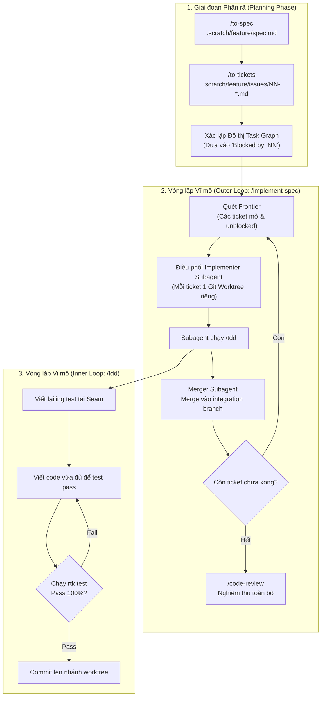

# Hướng dẫn chạy vòng lặp tự động (Autonomous Loop) với Bộ Skill Matt Pocock

Tài liệu này hướng dẫn cách cấu hình và vận hành vòng lặp tự chạy (Autonomous Execution Loop) cho coding agent bằng bộ skill của Matt Pocock.

---

## 1. Bản chất của "Loop" trong Bộ Skill Matt Pocock

### 1.1. Giải ảo hiểu nhầm về `loop-me`
Nhiều người dùng nhầm lẫn skill `loop-me` là kịch bản chạy lặp code tự động. **Thực tế không phải**:
* **`loop-me`** (`.agents/skills/loop-me/SKILL.md`): Là một session phỏng vấn (`grilling`) giúp người dùng thiết kế đặc tả quy trình tự động hóa (workflow spec: `workflows/*.md`) cho các thói quen lặp lại trong đời sống hoặc công việc (quản lý email, triage issue, tổng hợp tin tức...). Nó dùng "lăng kính vòng lặp" (*the loop lens*) với 4 khái niệm: **Trigger**, **Checkpoint**, **Push right**, và **Brief**.
* **Vòng lặp chạy code tự động thực sự** trong bộ skill được cấu thành từ sự kết hợp của:
  1. **Hệ thống Task Graph & Frontier**: Sinh ra từ `/to-spec` và `/to-tickets`.
  2. **Vòng lặp Vĩ mô (Outer Loop)**: `/implement-spec` (điều phối song song qua Git Worktrees).
  3. **Vòng lặp Vi mô (Inner Loop)**: `/tdd` (chu trình Red $\rightarrow$ Green test-driven development).

---

## 2. Kiến trúc Vòng lặp: Outer Loop & Inner Loop

Bộ skill của Matt Pocock không dựa vào một vòng lặp `while` đơn điệu làm ngập context window. Nó chia việc thành đồ thị có hướng (DAG) và giải quyết độc lập:



---

## 3. Chạy Vòng lặp tự động: Native Agent-Orchestrated Loop (`/implement-spec`)
*Dành cho môi trường hỗ trợ Subagent đồng thời (Antigravity IDE, Claude Code đa luồng).*

### 3.1. Nguyên lý vận hành
1. Đọc toàn bộ spec và danh sách tickets trong `.scratch/<feature>/issues/`.
2. Lập **integration branch** (nhánh tích hợp chung).
3. Xác định **Frontier**: Tập hợp các ticket không có trường `Blocked by` hoặc các ticket bị chặn bởi những ticket đã `resolved`.
4. Khởi chạy song song các **Implementer Subagent**, **mỗi ticket một subagent mới**:
   * Mỗi subagent bắt đầu với **context window mới** (không fork phiên điều phối), chỉ nhận context pointer tới spec và ticket.
   * Mỗi subagent nhận một **Git Worktree riêng biệt** (không can thiệp lẫn nhau).
   * Subagent gọi skill `/tdd` để code và chạy kiểm thử.
5. Khi một subagent hoàn tất:
   * **Merger Subagent** sẽ gộp code vào `integration branch`.
   * Việc merge này tự động mở khóa các ticket tiếp theo trong đồ thị $\rightarrow$ Frontier mở rộng $\rightarrow$ tiếp tục kích hoạt subagent mới.
6. Khi đồ thị giải quyết xong: Chạy `/code-review`, giao việc sửa các vấn đề review cho một implementer subagent mới, dọn dẹp các worktree tạm, và đóng các ticket.

### 3.2. Cách sử dụng
```text
# Bước 1: Chuẩn bị spec và tickets
/to-spec
/to-tickets

# Bước 2: Kích hoạt toàn bộ chu trình tự động
/implement-spec
```

---

## 4. Các quy tắc an toàn khi để Agent chạy tự động

1. **Bắt buộc dùng Token Killer (RTK)**:
   * Khi agent tự chạy, đầu ra terminal có thể tràn ngập log test và build khiến context window phình to nhanh chóng.
   * Luôn tiền tố các lệnh kiểm thử và git bằng `rtk` (ví dụ: `rtk test`, `rtk cargo test`, `rtk git status`). RTK sẽ loại bỏ 60–90% token rác và chỉ giữ lại đúng phần lỗi cần sửa.
2. **Kích hoạt Git Guardrails**:
   * Sử dụng skill `git-guardrails-claude-code` để cài đặt pre-tool hooks.
   * Chặn hoàn toàn các lệnh phá hoại như `git push -f`, `git reset --hard`, `git branch -D` trong suốt quá trình agent tự chạy.
3. **Giới hạn số lần thử (Circuit Breaker)**:
   * Không bao giờ để vòng lặp sửa lỗi chạy vô hạn. Nếu sau 3–5 lần thử `rtk test` vẫn không pass, rollback code (`git restore .`) và chuyển ticket thành `ready-for-human`.
4. **Không chạy song song trên cùng một Working Directory**:
   * Nếu chạy nhiều ticket song song, bắt buộc phải dùng **Git Worktree** (như cách `/implement-spec` làm) để tránh hai agent cùng sửa chung một file dẫn đến xung đột ghi đè.

---

## 5. Bảng tổng hợp công cụ điều phối vòng lặp

| Tác vụ | Skill / Công cụ | Vai trò trong Loop |
| :--- | :--- | :--- |
| **Phân tích yêu cầu lặp lại** | `/loop-me` | Phỏng vấn làm rõ quy trình thường nhật (Human Workflow Spec) |
| **Chia nhỏ đồ thị công việc** | `/to-spec` $\rightarrow$ `/to-tickets` | Sinh ra các Tracer-bullet tickets có ràng buộc phụ thuộc |
| **Điều phối tự động song song** | `/implement-spec` | Outer Loop: Frontier + Subagents + Worktrees + Code Review |
| **Thực thi kiểm thử đỏ-xanh** | `/tdd` | Inner Loop: Red $\rightarrow$ Green tại seam/interface |
| **Điều tra và gỡ lỗi lặp lại** | `/diagnosing-bugs` (`hitl-loop.template.sh`) | Feedback Loop: Tái hiện, cô lập lỗi và regression test |
| **Tối ưu đầu ra kiểm thử** | `rtk` | Token filter: Ngăn log test làm nghẽn bộ nhớ agent |

