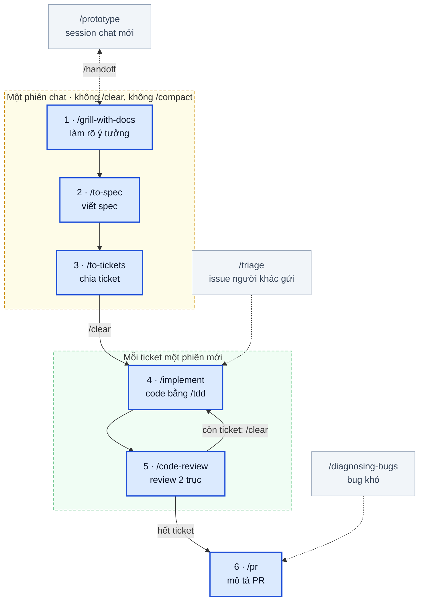
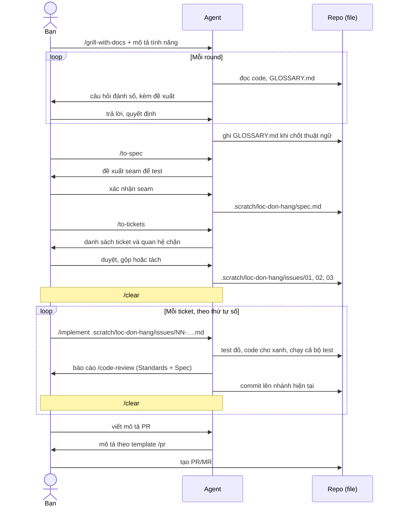

# Nhập môn bộ skill Matt Pocock

Hướng dẫn này dành cho dev đã quen làm việc với agent và skill, cần nắm nhanh **cách bộ skill Matt Pocock tổ chức công việc** và dùng nó trong các tình huống cụ thể. Đọc mất khoảng 10 phút; phần thực hành mất khoảng nửa ngày. Đọc xong, bạn cấu hình được repo và làm trọn một việc nhỏ có thật theo **main flow**: làm rõ ý tưởng → spec → ticket → code → review → PR.

Hướng dẫn viết theo bộ skill ngày 2026-10-31. Muốn tra chi tiết từng skill (cả 38 skill), hoặc xem bản mới đổi gì, thì xem [tài liệu tham chiếu](./matt-pocock-skills.md). Thuật ngữ gốc tiếng Anh (frontier, seam, tracer bullet…) được giữ nguyên, vì agent dùng đúng những từ này khi làm việc với bạn.

---

## 1. Bộ skill này là gì, vì sao nên dùng

[mattpocock/skills](https://github.com/mattpocock/skills) là một bộ 38 skill dành cho kỹ sư phần mềm. Nó giải quyết những lỗi quen thuộc khi làm việc với agent: agent đoán thay vì hỏi, code chạy nhưng sai yêu cầu, việc lớn làm trong một phiên dài nên agent "quên" giữa chừng, test viết cho có. Cách bộ skill giải quyết:

- **Phỏng vấn trước khi code.** Agent hỏi bạn từng vòng cho tới khi hai bên hiểu nhau, và ghi lại thuật ngữ đã chốt.
- **Chia việc thành ticket vừa một phiên.** Mỗi ticket là một lát cắt dọc chạy được, nên mỗi lần làm có thể bắt đầu từ context sạch.
- **Test trước, review hai chiều.** Code được viết theo TDD, và được review theo cả chuẩn code lẫn spec.

Bạn không cần nhớ hết 38 skill. Hướng dẫn này chỉ dùng 8 skill lõi, cộng 6 skill nên biết để gọi khi cần.

---

## 2. Bức tranh tổng thể

Bộ skill có bốn phần. Bảng dưới cho biết mỗi phần gồm skill nào và bạn phải làm gì với nó:

| Phần | Gồm | Bạn làm gì |
|---|---|---|
| **Main flow** | 6 bước trong hình bên dưới | Gõ lệnh từng bước; mục 4 hướng dẫn chi tiết |
| **Lối phụ** | `/prototype`, `/triage`, `/diagnosing-bugs`, `/ask-matt` | Gọi khi gặp đúng tình huống; xem mục 7 |
| **Nền** | `grilling` (phỏng vấn), `domain-modeling` (thuật ngữ nghiệp vụ), `codebase-design` (từ vựng thiết kế module) | Không cần gọi; các skill ở main flow tự dùng |
| **Cấu hình** | `/setup-matt-pocock-skills` → mục `## Agent skills` trong `CLAUDE.md` hoặc `AGENTS.md` → `docs/agents/*.md` | Chạy một lần cho mỗi repo; xem mục 3.1 |

Main flow, ranh giới phiên chat và chỗ các lối phụ nhập vào:



- **Ô xanh** là main flow, đánh số khớp với 6 bước ở mục 4.
- **Khung nét đứt** là ranh giới phiên chat:
  - Bước 1–3 nằm trong **một phiên**, vì spec và ticket cần lập luận nguyên bản của buổi phỏng vấn.
  - Từ bước 4, **mỗi ticket một phiên mới** (`/clear` trước khi bắt đầu), vì mỗi ticket đã đủ thông tin.
  - `/implement` tự gọi `/code-review`, nên bước 4 và 5 nằm chung một phiên. Xem thêm mục 6.
- **Ô xám** là lối phụ. `/prototype` là đường vòng khi một câu hỏi phải chạy thử mới trả lời được. `/triage` biến issue do người khác gửi vào thành việc sẵn sàng cho `/implement`. `/diagnosing-bugs` sửa bug khó kèm regression test.

---

## 3. Chuẩn bị repo (làm một lần)

Cài bộ skill như mọi bộ skill khác (`npx skills@latest add mattpocock/skills` hoặc plugin; lệnh cho từng công cụ ở [§2.1 tài liệu tham chiếu](./matt-pocock-skills.md#21-cấu-trúc-sau-khi-cài-bằng-npx-skills)). Hai điểm riêng của bộ này:

- **Phải có `setup-matt-pocock-skills`**: các skill quy trình đọc cấu hình do skill này tạo ra (mục 3.1).
- **Skill quy trình không tự chạy.** `/to-spec`, `/to-tickets`, `/implement`… là user-invoked, agent không tự kích hoạt; bạn gõ lệnh từng bước. Các skill "nguyên liệu" (`/tdd`, `/code-review`, `grilling`…) thì agent và skill khác tự gọi.

### 3.1. Cấu hình repo: `/setup-matt-pocock-skills`

Chạy một lần cho mỗi repo, trước khi làm việc đầu tiên. Agent khám phá repo rồi hỏi ba câu:

1. **Issue tracker** (nơi lưu spec và ticket): chọn **Local markdown**. Spec và ticket sẽ là file trong `.scratch/` của repo, nên bạn thấy tận mắt từng thứ được tạo ra, và không cần quyền ghi lên tracker nào.
2. **Nhãn triage**: giữ mặc định.
3. **Domain docs**: giữ mặc định (một `GLOSSARY.md` và thư mục `docs/adr/` ở gốc repo, tạo khi cần).

Agent cho bạn xem bản nháp, rồi ghi mục `## Agent skills` vào `CLAUDE.md` (hoặc `AGENTS.md` nếu repo dùng file đó) cùng ba file trong `docs/agents/`.

### 3.2. `.scratch/`: commit hay gitignore?

- **Repo dùng chung với nhóm (khuyến nghị mặc định): thêm `.scratch/` vào `.gitignore`.** Spec và ticket là đồ làm việc của bạn; để chúng lọt vào PR/MR sẽ gây nhiễu cho người review.
- **Repo cá nhân, hoặc nhóm muốn lưu spec cùng code: commit `.scratch/`.** Lịch sử quyết định đi cùng code.

---

## 4. Vòng thực hành đầu tiên

### 4.1. Chọn việc

Chọn **một việc nhỏ có thật** trên dự án của bạn:

- làm xong trong khoảng nửa ngày;
- có hành vi kiểm chứng được (người dùng thấy, hoặc test được);
- repo chạy được test, hoặc ít nhất build và chạy được;
- không đụng tới hạ tầng hay secret.

Ví dụ: thêm một bộ lọc, một trường mới, một quy tắc kiểm tra dữ liệu, sửa một lỗi hiển thị. Mục 5 có một ví dụ đi trọn vòng để bạn đối chiếu.

### 4.2. Sáu bước

> [!IMPORTANT]
> Làm bước 1–3 trong **cùng một phiên chat**, không `/clear` hay `/compact` giữa chừng. Spec và ticket cần lập luận nguyên bản của buổi phỏng vấn.

**Bước 1. Làm rõ ý tưởng: `/grill-with-docs`**

- **Gõ:** `/grill-with-docs` kèm 2–3 câu mô tả việc muốn làm.
- **Agent làm gì:** tự đọc code liên quan, rồi hỏi theo từng **round**. Mỗi câu hỏi được đánh số và có câu trả lời agent đề xuất. Khi bạn dùng một từ mơ hồ hoặc trái với glossary, agent sẽ hỏi lại cho rõ.
- **Bạn làm gì:** trả lời gọn, ví dụ `Q1 yes, Q2 b, Q3: không, vì…`. Câu hỏi được viết sao cho "yes" là đồng ý với đề xuất. Agent tự tra *dữ kiện*; *quyết định* là của bạn.
- **File sinh ra:** `GLOSSARY.md` khi một thuật ngữ được chốt; hiếm khi có ADR trong `docs/adr/`.
- **Xong khi:** agent tóm tắt toàn bộ những gì đã thống nhất và bạn xác nhận là đúng.

> [!NOTE]
> **Trên Copilot:** `/grill-with-docs` chỉ là một dòng "gọi skill `grilling` và `domain-modeling`". Tài liệu của VS Code chưa xác nhận Copilot có cơ chế để skill gọi skill khác. Nếu agent không hỏi theo round đánh số kèm đề xuất, hãy gõ thẳng `/grilling` và thêm "dùng cả skill domain-modeling".

**Bước 2. Viết spec: `/to-spec`**

- **Agent làm gì:** tổng hợp những gì đã bàn thành spec, **không hỏi thêm**, ngoại trừ một việc: đề xuất các **seam** (chỗ đặt test, ví dụ một API hay một hàm công khai) để bạn xác nhận.
- **Bạn làm gì:** duyệt seam. Seam càng ít và càng ở tầng cao càng tốt.
  - **Seam** là chỗ test gọi vào để quan sát hành vi, không chọc vào bên trong. Ví dụ "duyệt đơn nghỉ phép": seam có thể là endpoint HTTP, hàm `LeaveApproval.decide()`, hay từng hàm private bên trong.
  - **Cao** (gần người dùng) thì một test phủ nhiều code thật và không gãy khi refactor. **Ít** thì ít test phải bảo trì. Chọn seam cao nhất mà test vẫn nhanh và không cần hệ thống ngoài thật.
  - Mỗi seam được đề xuất kèm một dòng "bắt được gì, bỏ sót gì". Đọc dòng "bỏ sót" để quyết định có cần thêm seam không. Chi tiết: [§2.9 tài liệu tham chiếu](./matt-pocock-skills.md#29-seam-test-đặt-ở-đâu).
- **File sinh ra:** `.scratch/<feature>/spec.md`, gồm Problem, Solution, User Stories, Implementation Decisions, Testing Decisions, Out of Scope.
- **Xong khi:** file spec tồn tại và nội dung khớp với những gì đã thống nhất.

**Bước 3. Chia ticket: `/to-tickets`**

- **Agent làm gì:** đề xuất danh sách ticket. Mỗi ticket là một **tracer bullet**: một lát cắt dọc qua mọi tầng, chạy và kiểm chứng được một mình. Mỗi ticket ghi rõ ticket nào **chặn** nó.
- **Bạn làm gì:** duyệt độ mịn (quá to hay quá vụn), quan hệ chặn nhau, gộp hoặc tách.
- **File sinh ra:** `.scratch/<feature>/issues/01-….md`, `02-….md`…, đánh số theo thứ tự làm.
- **Xong khi:** các file ticket tồn tại. Từ đây được phép `/clear`.

**Bước 4. Code từng ticket: `/implement`**

- **Gõ:** `/clear`, rồi `/implement .scratch/<feature>/issues/01-….md`. Làm theo thứ tự số; ticket bị chặn thì đợi ticket chặn nó xong.
- **Agent làm gì:** đọc ticket và nhắc lại tiêu đề để bạn chắc là đúng ticket. Sau đó viết code theo **TDD** ở các seam đã chốt: một test đỏ, đủ code cho test xanh, lặp lại. Agent chạy typecheck thường xuyên, chạy cả bộ test ở cuối, rồi gọi `/code-review`.
- **Bạn làm gì:** theo dõi, trả lời khi agent hỏi, đọc kết quả review (bước 5).
- **File sinh ra:** code và test trên nhánh hiện tại.
- **Xong khi:** test xanh, review không còn vấn đề cần sửa.

> [!NOTE]
> Skill `/implement` kết thúc bằng việc **tự commit lên nhánh hiện tại**. Nếu nhóm bạn không cho agent commit, hãy dặn agent ngay khi gọi: "dừng trước bước commit, chỉ đề xuất commit message".

Xong một ticket thì `/clear` rồi làm ticket tiếp theo. Mỗi ticket đã chứa đủ thông tin, nên context của ticket trước không cần giữ.

**Bước 5. Review: `/code-review`**

`/implement` tự chạy bước này. Bạn cũng có thể gọi riêng để review cả nhánh, ví dụ `/code-review main`. Báo cáo có hai phần, cố ý tách riêng:

- **Standards:** code có theo chuẩn của repo không (cộng một danh sách code smell kinh điển).
- **Spec:** code có làm đúng, đủ, không thừa so với spec không.

Code có thể đạt trục này mà trượt trục kia. Đọc cả hai.

**Bước 6. Mô tả PR: `/pr`**

- **Gõ:** nhờ agent "viết mô tả PR cho nhánh này". Skill `/pr` được agent tự dùng khi viết mô tả PR.
- **Kết quả:** mô tả gồm **Summary** (hình nhỏ nhất thể hiện thay đổi), **Evidence** (trước và sau: test, output, ảnh chụp) và **Merge Danger** (đảo ngược được hay không, ảnh hưởng tới đâu).

---

## 5. Một việc đi qua hệ thống

Ví dụ minh hoạ: thêm tính năng **lọc danh sách đơn hàng theo trạng thái**, slug `loc-don-hang`. Ví dụ không gắn với ngôn ngữ hay framework nào.



**Bước 1: một round phỏng vấn (rút gọn)**

```text
❓ Q1 - Lọc một hay nhiều trạng thái: Người dùng chọn một trạng thái,
   hay chọn được nhiều trạng thái cùng lúc?
➡️ Đề xuất: làm một trạng thái trước, nhiều trạng thái làm sau.

❓ Q2 - Lọc ở đâu: Lọc ở server (truy vấn) hay lọc trên danh sách đã tải?
➡️ Đề xuất: ở server, vì danh sách có phân trang.

Bạn: Q1 ok, Q2 ok. Ngoài ra "đơn đã huỷ" cũng phải lọc được.

Agent: Bạn đang dùng cả "trạng thái" và "tình trạng" cho cùng một thứ.
       Chốt "Trạng thái đơn hàng" và ghi vào GLOSSARY.md nhé?
```

Mục được thêm vào `GLOSSARY.md`:

```markdown
**Trạng thái đơn hàng**:
Giai đoạn hiện tại của một đơn hàng trong vòng đời xử lý, ví dụ: mới, đang giao, đã giao, đã huỷ.
_Avoid_: tình trạng, state
```

**Bước 2: spec (rút gọn)**

```markdown
## Problem Statement
Nhân viên phải cuộn qua toàn bộ danh sách để tìm các đơn hàng ở một trạng thái.

## Solution
Danh sách đơn hàng có bộ lọc theo Trạng thái đơn hàng.

## User Stories
1. As a nhân viên, I want lọc theo một trạng thái, so that tôi thấy ngay các đơn cần xử lý
2. As a nhân viên, I want chọn nhiều trạng thái, so that tôi xem "đang giao" và "đã giao" cùng lúc
3. As a nhân viên, I want bộ lọc giữ nguyên khi tải lại trang, so that tôi không phải chọn lại

## Implementation Decisions
- Lọc ở server; truy vấn danh sách đơn hàng nhận thêm tham số trạng thái (một hoặc nhiều).

## Testing Decisions
- Một seam duy nhất: truy vấn lấy danh sách đơn hàng. Test qua seam này, không test chi tiết bên trong.

## Out of Scope
- Lọc theo ngày, theo khách hàng.
```

**Bước 3: ba ticket**

| File | Tên | Bị chặn bởi |
|---|---|---|
| `01-loc-theo-mot-trang-thai.md` | Lọc theo một trạng thái (truy vấn + giao diện + test) | Không |
| `02-loc-nhieu-trang-thai.md` | Chọn nhiều trạng thái cùng lúc | 01 |
| `03-giu-bo-loc-khi-tai-lai.md` | Giữ bộ lọc khi tải lại trang | 01 |

Nội dung một file ticket:

```markdown
# 02: Chọn nhiều trạng thái cùng lúc

**What to build:** Nhân viên chọn được nhiều Trạng thái đơn hàng; danh sách chỉ hiện đơn thuộc một trong các trạng thái đã chọn.

**Blocked by:** 01

**Status:** ready-for-agent

- [ ] Chọn "đang giao" và "đã giao" thì chỉ hiện đơn ở hai trạng thái này
- [ ] Bỏ chọn hết thì hiện toàn bộ đơn hàng
```

Ticket mô tả **hành vi**, không ghi đường dẫn file hay số dòng: agent tự tìm chỗ sửa khi làm.

**Bước 6: mô tả PR (rút gọn)**

````markdown
## Summary
```diff
 getOrders(query)
+  if query.statuses is not empty
+    keep only orders whose status is in query.statuses
   paginate
```

## Evidence
- **Before:** test "lọc theo trạng thái đang giao" đỏ (trả về mọi đơn)
  **After:** test xanh, chỉ trả về đơn đang giao

## Merge Danger
**Door:** two-way
**Blast Radius:** nhỏ
````

**Repo sau một vòng**

```text
<repo>/
├── GLOSSARY.md                        ← mới: "Trạng thái đơn hàng"
├── .scratch/loc-don-hang/
│   ├── spec.md
│   └── issues/
│       ├── 01-loc-theo-mot-trang-thai.md
│       ├── 02-loc-nhieu-trang-thai.md
│       └── 03-giu-bo-loc-khi-tai-lai.md
└── (code và test của tính năng, trên nhánh làm việc)
```

---

## 6. Giữ context gọn

1. **Không `/clear` trước khi `/to-tickets` xong.** Buổi phỏng vấn là nguồn gốc của spec và ticket; bản tóm tắt luôn mất chi tiết.
2. **`/clear` giữa các ticket.** Mỗi ticket tự đủ thông tin; context cũ chỉ làm agent nhiễu.
3. **Dùng `/handoff` khi việc phải "đi xa":** đổi công cụ, đổi repo, giao cho đồng nghiệp, hoặc tách một việc phụ ra phiên khác. Skill này ghi một file bàn giao để phiên mới đọc và làm tiếp.

---

## 7. Skill nên biết để gọi

| Khi bạn… | Gõ |
|---|---|
| Không biết nên dùng skill nào | `/ask-matt` |
| Gặp bug khó: chập chờn, hồi quy, chậm, không thấy nguyên nhân | `/diagnosing-bugs` |
| Có câu hỏi thiết kế phải thấy mới quyết được (state machine, giao diện) | `/prototype`, làm trong **session chat mới**, nối với phiên grill bằng `/handoff` hai chiều ([cách làm](./matt-pocock-skills.md#bước-2-nhánh-prototype-khi-giấy-bút-không-đủ)) |
| Đang grill thì gặp câu hỏi mà chỉ người khác trả lời được | Trả lời "chưa biết, đánh dấu PENDING", rồi `/to-questionnaire` ngay trong phiên đó; chưa `/to-spec` khi còn câu PENDING ([cách làm](./matt-pocock-skills.md#khi-gặp-câu-hỏi-bạn-không-tự-trả-lời-được)) |
| Muốn học một chủ đề mới qua nhiều buổi | `/teach`, trong một thư mục riêng cho chủ đề ([cách làm](./matt-pocock-skills.md#teach-dùng-thế-nào)) |
| Cần chuyển việc sang phiên, công cụ hoặc người khác | `/handoff` |
| Không hiểu agent vừa nói gì | `/wait-what` |
| Có issue do người khác gửi vào, cần phân loại và làm rõ | `/triage` |

Các skill còn lại (cả 38) có trong [tài liệu tham chiếu](./matt-pocock-skills.md).

---

## 8. Dùng ngoài Claude Code (Copilot, Kiro, Antigravity, Codex)

Bộ skill viết cho Claude Code và dựa vào hai cơ chế mà công cụ khác chưa chắc có:

1. **Skill gọi skill.** Nhiều skill chỉ là lời dặn "gọi skill X" (`/grill-with-docs` gọi `grilling` + `domain-modeling`; `/implement` gọi `tdd` + `code-review`). Nếu agent không làm đúng, gọi thẳng skill con, hoặc chỉ đường dẫn `SKILL.md` của nó trong prompt.
2. **Chặn agent tự gọi skill quy trình.** Kiro và Antigravity bỏ qua `disable-model-invocation`, nên agent có thể tự chạy `/to-tickets` hay `/implement`. Codex dùng cờ riêng `allow_implicit_invocation: false` trong `agents/openai.yaml`.

---

## 9. Case study: nhận dự án không có tài liệu

Bộ skill **không có skill riêng** cho việc tiếp nhận codebase lạ, nhưng ghép được từ các skill có sẵn. Hai điều cần nhớ:

- **Không viết lại tài liệu kiến trúc đầy đủ.** Bộ skill chỉ đọc 5 loại tài liệu nhỏ (bảng dưới). Những gì nằm ngoài 5 loại đó thì không skill nào đọc.
- **Agent rút ra dữ kiện, con người xác nhận ý nghĩa.** Mọi thứ chỉ là suy đoán từ code thì giữ ở trạng thái PENDING, không ghi vào tài liệu chính thức.

| Tài liệu | Skill nào đọc | Rút từ đâu trong code |
|---|---|---|
| `docs/agents/*.md` và mục `## Agent skills` | các skill dùng tracker, domain docs | Không rút từ code, đây là cấu hình |
| `GLOSSARY.md` | grill-with-docs, to-spec, improve-codebase-architecture… | enum trạng thái, bảng/cột DB, nhãn UI, file i18n, đường dẫn API |
| `docs/adr/NNNN-*.md` | improve-codebase-architecture, grilling | chỗ code "lạ", commit message, `git blame` |
| `CODING_STANDARDS.md` (hoặc `CONTRIBUTING.md`) | code-review (trục Standards) | quy ước lặp lại giữa các module, cấu hình linter |
| Navigation pointer trong `CLAUDE.md`/`AGENTS.md` | mọi agent, vì file này luôn được nạp vào context | bản đồ module |

### Các bước

1. **Cấu hình.** Chạy `/setup-matt-pocock-skills`; với Claude Code, chạy thêm `/git-guardrails-claude-code` trước khi để agent làm việc trong repo bạn chưa hiểu.
2. **Lập bản đồ.** Chạy `/improve-codebase-architecture` và nói rõ *"chỉ khảo sát, chưa refactor"*.
   - Bạn lấy từ đây danh sách module và **hot spot**, tức vùng hay bị sửa theo `git log`. Các bước 3–6 chỉ làm cho hot spot, không cố phủ cả hệ thống.
   - Báo cáo HTML nằm trong thư mục temp, nên tự lưu lại nếu muốn giữ.
3. **Dựng `GLOSSARY.md`.** Gọi thẳng `/domain-modeling`:

   ```text
   /domain-modeling Đọc module <X>: enum/hằng trạng thái, bảng DB, nhãn UI, file i18n.
   Đề xuất thuật ngữ nghiệp vụ, mỗi lượt hỏi tôi xác nhận một nhóm.
   Thuật ngữ nào tôi không chắc nghĩa thì đánh dấu PENDING, không ghi vào GLOSSARY.md.
   ```

   - Glossary không chứa chi tiết cài đặt.
   - Khi code, UI và người dùng gọi cùng một thứ bằng nhiều tên, chọn một tên chuẩn và đưa các tên còn lại vào `_Avoid_`.
   - Enum trạng thái là nguồn tốt nhất, vì mỗi trạng thái và mỗi bước chuyển giữa chúng thường là một thuật ngữ nghiệp vụ.
4. **Tìm câu hỏi "vì sao".** Cũng với `/domain-modeling`: yêu cầu agent tìm chỗ code khiến người đọc phải hỏi "sao lại làm thế này?", đọc `git log`/`blame` ở đó, rồi nêu giả thuyết và đánh dấu PENDING. Chưa viết ADR.
5. **Hỏi người biết.** Chạy `/to-questionnaire` gom các câu PENDING ở bước 3 và 4, gửi dev cũ, BA hoặc khách hàng. Có câu trả lời thì đưa vào `GLOSSARY.md`, rồi viết ADR. ADR chỉ viết khi đủ 3 điều kiện:
   - khó đảo ngược;
   - gây ngạc nhiên nếu thiếu bối cảnh;
   - là kết quả của một đánh đổi thật.

   Một ADR viết từ giả thuyết sai còn hại hơn không có ADR, vì `improve-codebase-architecture` coi ADR là quyết định đã chốt và không bàn lại.
6. **Dựng chuẩn code.** Yêu cầu agent so sánh 3–4 module, liệt kê các quy ước được tuân thủ nhất quán, kèm ví dụ `file:dòng`. Chia kết quả thành hai loại:
   - **Lỗi máy móc** (API bị cấm, dạng import, vị trí file): làm thành linter rule, pre-commit hook hoặc CI job.
   - **Việc cần phán đoán:** ghi vào `CODING_STANDARDS.md`.

   Chỗ code xấu sẵn có thì không biến thành chuẩn.
7. **Viết navigation pointer.** Thêm vài dòng vào `CLAUDE.md`/`AGENTS.md`, dùng tên từ `GLOSSARY.md`. Ví dụ: *"Logic <thuật ngữ A>: `src/.../AService`; đọc `docs/adr/0002-...` trước khi sửa."* Không viết mô tả kiến trúc dài, vì file này được nạp vào mọi phiên.
8. **Làm việc thật, rồi `/retro`.** Từ đây tài liệu lớn dần qua công việc:
   - `/diagnosing-bugs` hoặc main flow (mục 4); `/grill-with-docs` bổ sung `GLOSSARY.md` mỗi lần chạy;
   - `/retro` sau mỗi vài việc, để thêm pointer, chuẩn code và check tự động.
   - Stack lạ thì dùng `/teach`; API bên thứ ba thì dùng `/research`.

```text
setup → improve-codebase-architecture (bản đồ, hot spot)
      → domain-modeling: GLOSSARY + câu "vì sao" (PENDING)
      → to-questionnaire → ADR (chỉ khi đã xác nhận)
      → CODING_STANDARDS.md + check tự động → pointer trong CLAUDE.md
      → việc thật + retro định kỳ
```

---

## 10. Case study: xây sản phẩm mới từ ý tưởng

Đầu vào chỉ có ý tưởng, bài toán cần giải và vài tài liệu tham khảo. Bộ skill có tính đến tình huống này (trong `ask-matt`, đây là on-ramp "greenfield project"), và chia việc thành hai giai đoạn:

- **Giai đoạn đầu chỉ ra quyết định**, cho tới khi biết rõ phải làm gì.
- **Giai đoạn sau** mới nhập vào main flow để viết code.

### Bước 0. Tạo repo trước khi phỏng vấn

- Chạy `git init` cho một repo rỗng, rồi `/setup-matt-pocock-skills`. Có repo thì mới dùng được `/grill-with-docs` và `/wayfinder` (hai skill này lưu kết quả vào repo) thay vì `/grill-me` (không lưu gì).
- Đưa tài liệu tham khảo vào repo, ví dụ `docs/references/`, ở dạng Markdown. Agent đọc được thì mới trích dẫn được.
- Chọn tracker:
  - **local markdown** nếu làm một mình;
  - **GitLab/GitHub** nếu cả nhóm cần thấy cùng một map.

### Bước 1. Ý tưởng to hay nhỏ?

| Ý tưởng | Dùng |
|---|---|
| Nói rõ được trong một phiên (công cụ nhỏ, MVP rất hẹp) | `/grill-with-docs` rồi `/to-spec`, đi thẳng main flow |
| Còn mù mờ, nhiều quyết định phụ thuộc nhau, một phiên không chứa nổi | `/wayfinder` |

Không cần tự đoán: nếu ý tưởng không đủ mù mờ, `/wayfinder` tự nói là không cần map và hỏi bạn muốn đi tiếp thế nào.

### Bước 2. `/wayfinder`: từ ý tưởng tới quyết định

1. **Đặt destination.** Đích là một kết quả có thể giao lại, ví dụ *"spec MVP đủ để bắt đầu build"*. Không đặt đích là "sản phẩm chạy được". Việc nằm ngoài đích được ghi vào mục **Out of scope**.
2. **Lập frontier.** Agent phỏng vấn theo chiều rộng và sinh các **decision ticket**, gồm bốn loại:

   | Loại ticket | Ai làm | Dùng cho |
   |---|---|---|
   | `research` (agent tự làm) | subagent gọi `/research` | Rút dữ kiện từ tài liệu tham khảo, API bên thứ ba, nền tảng sẽ dùng |
   | `grilling` (cần bạn) | bạn và agent | Quyết định nghiệp vụ: đối tượng dùng, luồng chính, quy tắc. Thuật ngữ đã chốt được ghi vào `GLOSSARY.md` |
   | `prototype` (cần bạn) | bạn và agent | Giao diện hoặc state machine phải thấy mới quyết được |
   | `task` | agent, hoặc bạn theo checklist | Việc tay phải làm trước khi quyết, ví dụ đăng ký dịch vụ để thử API |

3. **Giải từng ticket.** Mỗi phiên chỉ giải **một ticket**, trừ ticket research. Mỗi câu trả lời làm rõ thêm phần còn mù mờ (mục **Not yet specified**) và sinh ra ticket mới. Map xong khi không còn gì phải quyết.

> [!WARNING]
> Khi giải ticket `research`, wayfinder **push** một nhánh `research/<name>`. Nếu nhóm bạn không cho agent push, hãy dặn agent ngay từ đầu: *"giữ nhánh research ở local, không push"*.

### Bước 3. Nhập vào main flow

- **`/to-spec`:** gộp các quyết định trên map thành spec có thể build. Không nhảy thẳng từ map sang `/implement`, vì sẽ mất các chi tiết liên kết giữa các quyết định.
- **`/to-tickets`:** ticket đầu tiên là một **tracer bullet**, tức một lát cắt mỏng chạy xuyên mọi tầng. Với sản phẩm mới, ticket này chính là bộ khung dự án.
- **Trước khi code, dựng hàng rào cho repo:**
  - `/git-guardrails-claude-code`;
  - `/setup-pre-commit`;
  - `/setup-ts-deep-modules` nếu dùng TypeScript;
  - một `CODING_STANDARDS.md` ngắn để `/code-review` có chuẩn mà kiểm tra.
- **Code:** `/implement` từng ticket, hoặc `/implement-spec` để chạy song song. Sau đó `/code-review` và `/pr`.

### Bước 4. Từ đó về sau

Mỗi tính năng mới đi theo main flow, bắt đầu từ `/grill-with-docs`. Chạy `/retro` định kỳ để bổ sung navigation pointer, chuẩn code và check tự động.

### Tài liệu sinh ra

| Tài liệu | Từ đâu |
|---|---|
| Wayfinder map (destination, các quyết định, out of scope) | `/wayfinder` |
| `GLOSSARY.md` | ticket grilling, `/grill-with-docs` |
| ADR (chọn stack, DB, kiến trúc) | grilling, khi đủ 3 điều kiện |
| Ghi chú research có trích dẫn | ticket research |
| `spec.md`, các ticket | `/to-spec`, `/to-tickets` |
| `CODING_STANDARDS.md`, pointer trong `CLAUDE.md` | tự viết ngắn ban đầu, `/retro` bổ sung |

### Bộ skill không làm thay bạn

- **Tài liệu kinh doanh:** business case, phân tích thị trường, PRD dạng văn bản cho khách hàng.
- **Thiết kế giao diện hoàn chỉnh:** `/prototype` chỉ là bản nháp để quyết định, làm xong thì bỏ.
- **Hạ tầng và triển khai:** `/wizard` chỉ hướng dẫn bạn từng bước làm việc tay, như tạo tài khoản hay secret.
- **Kế hoạch dự án:** ước lượng, lịch, phân công.

Những phần này bạn làm riêng. Kết quả có thể đưa vào map dưới dạng ticket `task`, hoặc làm tài liệu tham khảo cho ticket `research` và `grilling`.

```text
git init + setup → (tài liệu tham khảo vào docs/references/)
      → wayfinder: destination → frontier → giải từng ticket (research / grilling / prototype / task)
      → to-spec → to-tickets (ticket 1 = bộ khung) → guardrails + chuẩn code
      → implement / implement-spec → code-review → pr
      → tính năng sau: grill-with-docs … ; retro định kỳ
```

---

## 11. Đi tiếp

- Tra cứu cả 38 skill, kiến trúc và các on-ramp khác: [tài liệu tham chiếu](./matt-pocock-skills.md).
- Sau vài vòng, thử thêm:
  - `/retro`: nhìn lại một phiên để cải thiện môi trường cho agent;
  - `/implement-spec`: làm cả spec song song bằng subagent;
  - `/improve-codebase-architecture`: tìm chỗ nên refactor.
- Mã nguồn bộ skill: <https://github.com/mattpocock/skills>
