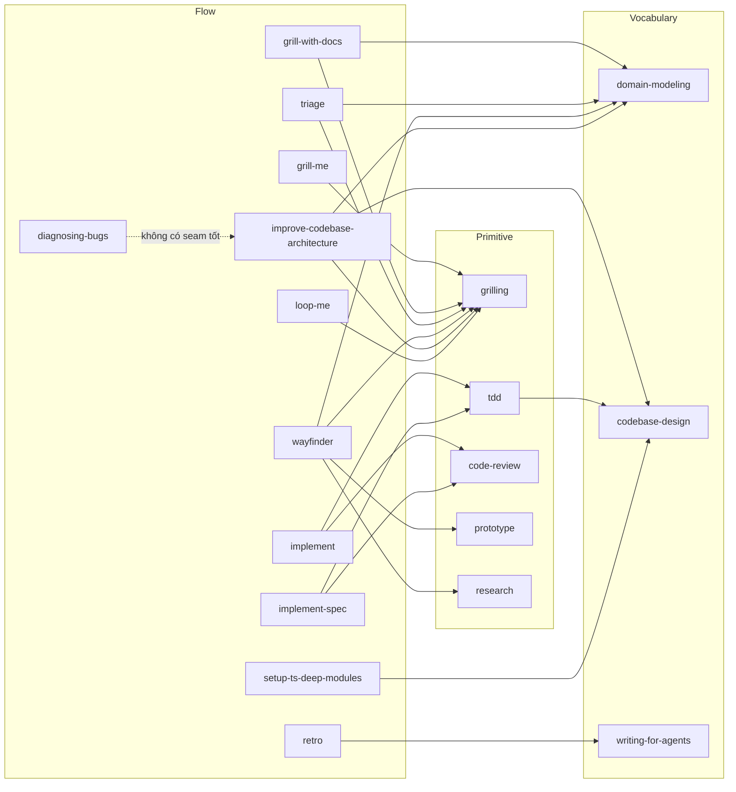
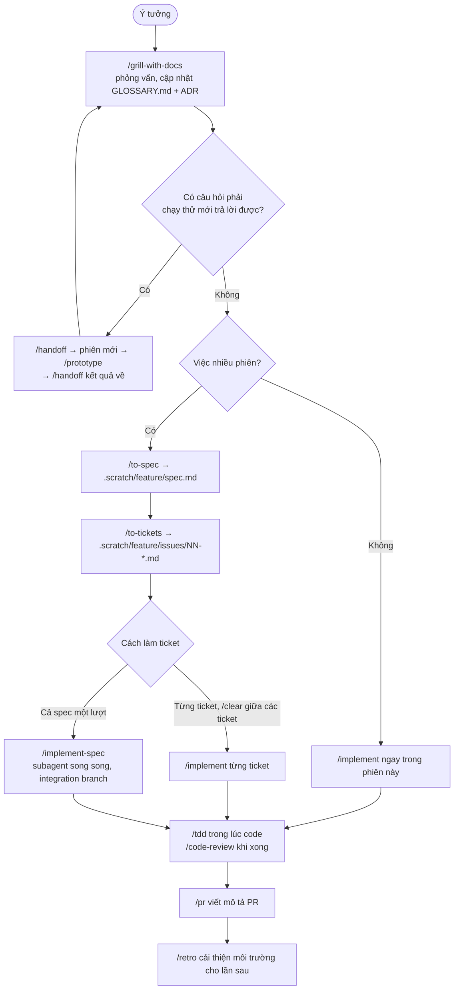

# Bộ skill Matt Pocock: kiến trúc và workflow

> Mới dùng lần đầu? Đọc [hướng dẫn nhập môn](./matt-pocock-skills-onboarding.md) trước; tài liệu này dùng để tra cứu.

Tài liệu này mô tả bộ skill [mattpocock/skills](https://github.com/mattpocock/skills): các skill được tổ chức thế nào, chúng nối với nhau ra sao, và dùng từng skill khi nào. Nội dung được rút ra từ chính các file `SKILL.md` của bộ skill.

**Phiên bản mô tả:** repo nguồn ngày 2026-10-31 (commit `4ae2317`). Những gì đổi so với bản trước nằm ở [mục 9](#9-nhật-ký-cập-nhật).

Thuật ngữ gốc của bộ skill (frontier, seam, tracer bullet…) được giữ nguyên tiếng Anh vì các skill dùng chính những từ này để điều khiển hành vi của agent; dịch đi sẽ mất móc nối.

---

## 1. Tóm tắt

- **38 skill**, chia theo thư mục gốc trên repo nguồn: `engineering` (20), `productivity` (7), `misc` (4), `in-progress` (7). Riêng `software-factory` hiện chưa cài được bằng `npx skills` (xem §7.4), nên bản cài trong repo có 37 skill.
- Bộ skill xoay quanh **một main flow**: *ý tưởng → phỏng vấn làm rõ → spec → ticket → TDD → review → PR → retro*. Có ba **on-ramp** nhập vào main flow (`/triage`, `/diagnosing-bugs`, `/wayfinder`), một skill bảo dưỡng codebase, một lớp **vocabulary** chạy bên dưới, và một nhóm skill **standalone**.
- Không nhớ dùng skill nào thì gõ **`/ask-matt`**: đó là skill router, chỉ đường tới các skill còn lại.
- Trước flow kỹ thuật đầu tiên phải chạy **`/setup-matt-pocock-skills`** (một lần cho mỗi repo): nó cho các skill biết issue nằm ở đâu, nhãn triage là gì, và glossary/ADR đặt ở đâu.

### Tra nhanh: tôi muốn… → dùng skill nào

| Tình huống | Skill |
|---|---|
| Có ý tưởng, muốn làm rõ trước khi code (đang ở trong repo) | `/grill-with-docs` |
| Muốn làm rõ một kế hoạch không gắn với repo nào | `/grill-me` |
| Đã thống nhất xong, cần viết spec | `/to-spec` |
| Chia spec thành các ticket làm được trong một phiên | `/to-tickets` |
| Làm một ticket (hoặc một việc nhỏ) | `/implement` |
| Làm cả spec song song bằng subagent | `/implement-spec` |
| Viết code test-first | `/tdd` |
| Review một nhánh / PR so với một mốc | `/code-review` |
| Viết mô tả PR | `/pr` (agent tự gọi) |
| Nhìn lại một phiên làm việc để cải thiện môi trường cho agent | `/retro` |
| Issue/bug do người khác gửi vào, cần phân loại | `/triage` |
| Bug khó, chập chờn, hồi quy, chậm | `/diagnosing-bugs` |
| Việc quá lớn, còn mù mờ, không vừa một phiên | `/wayfinder` |
| Rảnh tay, muốn tìm chỗ nên refactor | `/improve-codebase-architecture` |
| Câu hỏi thiết kế cần "thấy" mới quyết được | `/prototype` |
| Cần tra tài liệu gốc, giao cho agent chạy nền | `/research` |
| Câu trả lời nằm trong đầu người khác | `/to-questionnaire` |
| Bước chỉ con người làm được (tạo tài khoản, lấy secret…) | `/wizard` |
| Agent vừa nói gì đó khó hiểu | `/wait-what` |
| Chuyển việc sang phiên/công cụ/người khác | `/handoff` |
| Học một chủ đề qua nhiều phiên | `/teach` |
| Viết skill, `AGENTS.md`, `CLAUDE.md` | `/writing-for-agents` |

---

## 2. Kiến trúc

### 2.1. Cấu trúc sau khi cài bằng `npx skills`

Cài bằng `npx skills@latest add mattpocock/skills -a claude-code -a github-copilot` (CLI `skills` của vercel-labs), rồi chạy `/setup-matt-pocock-skills`, repo sẽ có dạng:

```
<repo>/
├── .agents/skills/<tên>/          ← bản gốc của mọi skill
│   ├── SKILL.md                   ← frontmatter + nội dung chính
│   ├── *.md                       ← tài liệu tham chiếu phụ (progressive disclosure)
│   ├── scripts/, template.sh …    ← tài nguyên chạy được
│   └── agents/openai.yaml         ← metadata cho Codex (display_name, allow_implicit_invocation)
├── .claude/skills/<tên>           ← symlink trỏ về .agents/skills/<tên> để Claude Code thấy
├── skills-lock.json               ← nguồn + đường dẫn + hash của từng skill đã cài
├── CLAUDE.md (hoặc AGENTS.md)     ← có mục "## Agent skills" trỏ tới docs/agents/
└── docs/agents/                   ← cấu hình per-repo mà các skill đọc
    ├── issue-tracker.md
    ├── triage-labels.md
    └── domain.md
```

Nếu cài dạng plugin thì không có `.agents/skills/`, `.claude/skills/` và `skills-lock.json` trong repo; phần cấu hình (`CLAUDE.md`, `docs/agents/`) vẫn như trên. Plugin tự cập nhật nhưng **không có các skill in-progress**.

| Công cụ | Lệnh cài plugin |
|---|---|
| Claude Code | `claude plugin install mattpocock-skills@claude-plugins-official` |
| GitHub Copilot (CLI) | `copilot plugin marketplace add mattpocock/skills`, sau đó `copilot plugin install mattpocock-skills@mattpocock` |
| GitHub Copilot (VS Code) | Lệnh **Chat: Install Plugin From Source**, nhập `https://github.com/mattpocock/skills` |
| Codex | `codex plugin marketplace add mattpocock/skills`, sau đó `codex plugin add mattpocock-skills@mattpocock` |

> [!WARNING]
> Mỗi công cụ chỉ chọn **một** cách cài (`npx skills` hoặc plugin). Cài cả hai thì mỗi skill xuất hiện hai lần.

Cập nhật bản cài bằng `npx skills`:

- `npx skills@latest update -p -y` cập nhật các skill **đã cài** của project. Lệnh này không thêm skill mới.
- Skill mới xuất hiện trên repo nguồn phải cài riêng: `npx skills@latest add mattpocock/skills --skill <tên> -a claude-code -a github-copilot`.
- Muốn biết bản mới đổi gì: nếu repo commit `.agents/skills/` thì xem `git diff` sau khi update; nếu không thì xem lịch sử commit của repo nguồn.

Mỗi skill là một thư mục có `SKILL.md`. Phần frontmatter quyết định cách skill được gọi; phần thân là quy trình hoặc tài liệu tham chiếu. Tài liệu dài được tách sang file anh em (ví dụ `tdd/mocking.md`, `triage/AGENT-BRIEF.md`) và chỉ được đọc khi cần. Bộ skill gọi cách làm này là *progressive disclosure*.

### 2.2. Hai kiểu gọi: model-invoked và user-invoked

Đây là quyết định kiến trúc quan trọng nhất của bộ skill (lý do nằm ở `writing-for-agents/SKILL-MECHANICS.md`):

- **Model-invoked** (không có `disable-model-invocation`): `description` luôn nằm trong context của agent, nên agent tự gọi được khi thấy hợp, và **skill khác gọi được nó**. Cái giá là luôn tốn context.
- **User-invoked** (`disable-model-invocation: true`): chỉ người gõ `/tên` mới gọi được, skill khác không gọi được. Không tốn context, nhưng người dùng phải nhớ là skill đó tồn tại. `/ask-matt` sinh ra để giảm gánh nhớ này.

| Model-invoked (15): agent và skill khác gọi được | User-invoked (23): chỉ người gõ lệnh |
|---|---|
| `grilling`, `domain-modeling`, `codebase-design`, `tdd`, `code-review`, `pr`, `diagnosing-bugs`, `prototype`, `research`, `wizard`, `writing-for-agents`, `git-guardrails-claude-code`, `setup-pre-commit`, `migrate-to-shoehorn`, `scaffold-exercises` | `ask-matt`, `setup-matt-pocock-skills`, `grill-me`, `grill-with-docs`, `to-spec`, `to-tickets`, `implement`, `implement-spec`, `triage`, `wayfinder`, `improve-codebase-architecture`, `retro`, `handoff`, `claude-handoff`, `wait-what`, `to-questionnaire`, `teach`, `loop-me`, `setup-ts-deep-modules`, `writing-fragments`, `writing-shape`, `writing-beats`, `software-factory` |

Quy luật dễ thấy: **các skill "nguyên liệu"** (phỏng vấn, từ vựng, TDD, review) là model-invoked để skill khác dựng lên trên được, còn **các skill "quy trình"** (flow) là user-invoked vì chỉ nên chạy khi người dùng chủ động muốn.

### 2.3. Các tầng

```
┌──────────────────────────────────────────────────────────────────────┐
│ Router            ask-matt                                           │
├──────────────────────────────────────────────────────────────────────┤
│ Flow (user)       grill-with-docs → to-spec → to-tickets → implement │
│                   / implement-spec → retro; triage; wayfinder;       │
│                   improve-codebase-architecture; diagnosing-bugs*    │
├──────────────────────────────────────────────────────────────────────┤
│ Primitive         grilling · tdd · code-review · pr · prototype ·    │
│ (model)           research · wizard                                  │
├──────────────────────────────────────────────────────────────────────┤
│ Vocabulary        domain-modeling (ngôn ngữ nghiệp vụ)               │
│ (model)           codebase-design (ngôn ngữ kiến trúc)               │
│                   writing-for-agents (ngôn ngữ viết cho agent)       │
├──────────────────────────────────────────────────────────────────────┤
│ Cấu hình          setup-matt-pocock-skills → CLAUDE.md + docs/agents │
└──────────────────────────────────────────────────────────────────────┘
* diagnosing-bugs là model-invoked nhưng đóng vai trò một flow
```

Hai skill tên quen nhất chỉ là **wrapper một dòng**:

- `grill-me` = "Call the Skill tool with `grilling`".
- `grill-with-docs` = gọi `grilling` **và** `domain-modeling`.

Tức là phần lõi nằm ở primitive; các skill flow chỉ ghép primitive lại theo một thứ tự.

### 2.4. Skill nào gọi skill nào



#### Cài riêng một skill

Không bắt buộc cài cả bộ. Một skill dùng được một mình khi nó **không gọi skill khác** và **không cần cấu hình** của `/setup-matt-pocock-skills`. Bảng dưới rút ra từ việc tìm "Call the Skill tool" và "`/setup-matt-pocock-skills`" trong từng `SKILL.md` (commit `4ae2317`):

| Nhóm | Skill | Cài kèm |
|---|---|---|
| **Độc lập** | `teach`, `to-questionnaire`, `wait-what`, `handoff`, `claude-handoff`, `prototype`, `research`, `wizard`, `pr`, `diagnosing-bugs`, `grilling`, `domain-modeling`, `codebase-design`, `writing-for-agents`, `git-guardrails-claude-code`, `setup-pre-commit`, `migrate-to-shoehorn`, `scaffold-exercises`, `writing-fragments`, `writing-shape`, `writing-beats`, `software-factory` | Không cần gì |
| **Cần skill khác** | `grill-me` | `grilling` |
| | `grill-with-docs` | `grilling`, `domain-modeling` |
| | `loop-me` | `grilling` |
| | `tdd`, `setup-ts-deep-modules` | `codebase-design` |
| | `retro` | `writing-for-agents` |
| | `improve-codebase-architecture` | `codebase-design`, `grilling`, `domain-modeling` |
| | `implement` | `tdd` (kéo theo `codebase-design`), `code-review`; cần cấu hình tracker nếu truyền tham chiếu ticket |
| **Cần skill khác và cấu hình** | `triage` | `grilling`, `domain-modeling` + `/setup-matt-pocock-skills` |
| | `wayfinder` | `grilling`, `domain-modeling`, `research`, `prototype` + `/setup-matt-pocock-skills` |
| | `implement-spec` | `tdd`, `codebase-design`, `code-review` + `/setup-matt-pocock-skills` |
| **Cần cấu hình** | `to-spec`, `to-tickets`, `code-review` | `/setup-matt-pocock-skills` |
| **Router** | `ask-matt` | Chạy được một mình, nhưng chỉ đường tới các skill khác nên chỉ có ích khi đã cài cả bộ |

Skill độc lập dùng ngoài repo (ví dụ `teach` dùng cho thư mục học riêng) nên cài **ở mức user** để mở thư mục nào cũng gọi được:

```bash
npx skills@latest add mattpocock/skills --skill teach -g -a claude-code -a github-copilot
npx skills@latest update -g -y   # cập nhật skill cài global
```

Bỏ `-g` thì skill chỉ được cài vào project hiện tại.

### 2.5. Cấu hình per-repo: cách các skill "biết" về repo

Các skill không chứa đường dẫn hay lệnh cố định cho một tracker cụ thể. Chúng nói bằng **vai trò trừu tượng** ("publish to the issue tracker", "apply the `ready-for-agent` label") và giả định cấu hình đã được đưa vào context. Chuỗi kết nối như sau:

1. `CLAUDE.md` được nạp vào context ở mọi phiên. Mục `## Agent skills` trong đó là các **context pointer** trỏ tới `docs/agents/*.md`.
2. Khi skill cần biết tracker hoặc nhãn, agent đi theo pointer, đọc file tương ứng và làm theo.
3. Nếu thiếu cấu hình, skill được dặn: *"tell the user to run `/setup-matt-pocock-skills`"*. Không skill nào ghi cứng đường dẫn `docs/agents/…`; chúng chỉ nói "the tracker doc".

| File cấu hình | Nội dung (khi chọn local markdown và các mặc định) | Skill dùng |
|---|---|---|
| `docs/agents/issue-tracker.md` | **Local markdown** dưới `.scratch/`: spec ở `.scratch/<feature>/spec.md`, ticket ở `.scratch/<feature>/issues/NN-<slug>.md`, trạng thái ghi bằng dòng `Status:`, bình luận nằm dưới `## Comments`, map của wayfinder ở `.scratch/<effort>/map.md` | `to-spec`, `to-tickets`, `triage`, `wayfinder`, `implement-spec`, `code-review` |
| `docs/agents/triage-labels.md` | 5 nhãn mặc định: `needs-triage`, `needs-info`, `ready-for-agent`, `ready-for-human`, `wontfix` | `triage`, `to-spec`, `to-tickets` (gắn `ready-for-agent`) |
| `docs/agents/domain.md` | Single-context: `GLOSSARY.md` và `docs/adr/` ở gốc repo; chưa có thì bỏ qua, không nhắc | Mọi skill có bước khám phá code: `tdd`, `diagnosing-bugs`, `to-spec`, `to-tickets`, `triage`, `improve-codebase-architecture`, `pr`, `wait-what`… |

Đổi tracker (GitHub, GitLab, Jira…) chỉ cần sửa `docs/agents/issue-tracker.md` hoặc chạy lại `/setup-matt-pocock-skills`; không phải sửa skill nào. Đây là điểm tách bạch chính của kiến trúc: **skill mô tả quy trình, repo mô tả nơi chốn**.

### 2.6. Trạng thái bền: skill ghi gì, ở đâu

Phần lớn skill không giữ trạng thái riêng. Thứ còn lại sau mỗi phiên là các file và nhánh sau:

| Sản phẩm | Vị trí | Skill tạo ra |
|---|---|---|
| Glossary nghiệp vụ | `GLOSSARY.md` (tạo khi có thuật ngữ đầu tiên) | `domain-modeling` (qua `grill-with-docs`, `triage`, `wayfinder`, `improve-codebase-architecture`) |
| Quyết định kiến trúc | `docs/adr/0001-<slug>.md` | `domain-modeling` |
| Spec | `.scratch/<feature>/spec.md` | `to-spec` |
| Ticket | `.scratch/<feature>/issues/NN-<slug>.md` | `to-tickets` |
| Map + ticket quyết định | `.scratch/<effort>/map.md`, `.scratch/<effort>/issues/` | `wayfinder` |
| Yêu cầu bị từ chối | `.out-of-scope/<concept>.md` | `triage` |
| Ghi chú nghiên cứu (có trích dẫn) | Theo quy ước sẵn có của repo | `research` |
| Nhánh prototype | `prototype/<name>` (ngoài main) | `prototype` |
| Báo cáo kiến trúc HTML | Thư mục temp của OS | `improve-codebase-architecture` |
| Tài liệu handoff | Thư mục temp của OS | `handoff` |
| Bảng hỏi | `to-questionnaire-<slug>.md` ở thư mục hiện tại | `to-questionnaire` |
| Chuẩn code cho reviewer | `CODING_STANDARDS.md` | `retro` đề xuất, `code-review` đọc |
| Không gian học | `MISSION.md`, `RESOURCES.md`, `NOTES.md`, `GLOSSARY.md`, `lessons/`, `reference/`, `learning-records/`, `assets/` (trong thư mục chạy `/teach`) | `teach` |
| Spec workflow cá nhân | `workflows/*.md`, `NOTES.md` | `loop-me` |

### 2.7. Các nguyên lý xuyên suốt

Đọc hết 38 skill sẽ thấy cùng một bộ nguyên lý lặp lại. Hiểu các nguyên lý này thì đoán được skill sẽ làm gì:

- **Facts là việc của agent, decisions là việc của người.** Khi phỏng vấn, agent tự tra những gì tra được (gửi subagent đi đọc code) và chỉ hỏi người những điều cần người quyết. Mỗi câu hỏi kèm câu trả lời agent đề xuất.
- **Frontier.** Mọi việc được tổ chức thành đồ thị phụ thuộc, và lúc nào cũng làm ở "rìa" của đồ thị: những việc đã đủ tiền đề. Xem [§2.8](#28-frontier-làm-ở-rìa-của-đồ-thị).
- **Tracer bullet / vertical slice.** Ticket cắt dọc qua mọi tầng (schema, API, UI, test), chạy được và kiểm chứng được độc lập. TDD cũng cắt dọc: một test, một đoạn code, rồi lặp lại; không viết hết test trước.
- **Seam.** Test chỉ đặt ở seam đã thống nhất với người dùng; seam càng cao càng tốt, càng ít càng tốt (lý tưởng là một). Xem [§2.9](#29-seam-test-đặt-ở-đâu).
- **Deep module.** Nhiều hành vi sau một interface nhỏ (`codebase-design`). Được dùng làm thước đo cho refactor, test và review.
- **Ngôn ngữ chung (ubiquitous language).** `GLOSSARY.md` là nguồn thuật ngữ duy nhất; spec, ticket, tên test, mô tả PR đều phải dùng đúng thuật ngữ đó.
- **Bền theo thời gian.** Spec, ticket và agent brief **không ghi đường dẫn file hay số dòng** vì những thứ đó cũ đi nhanh. Chúng mô tả hành vi, interface, kiểu dữ liệu. Ngoại lệ: đoạn code từ prototype diễn đạt quyết định chính xác hơn văn xuôi.
- **Primary source và secondary source.** Phiên làm việc nguyên bản là primary source; bản tóm tắt (`/compact`, `/handoff`) là secondary và luôn mất thông tin. Vì vậy ưu tiên giữ nguyên phiên khi còn có thể.
- **Smart zone (~150k token).** Vùng mà model còn suy luận sắc bén. Vượt quá thì nên dừng ở ranh giới phase gần nhất.
- **HITL và AFK.** Mỗi việc được xếp loại: cần người tham gia trực tiếp (human in the loop), hay agent làm một mình được (away from keyboard). Việc AFK được đẩy cho subagent.
- **Subagent bắt đầu với context mới, không fork.** Mọi skill giao việc cho subagent (`grilling`, `code-review`, `implement-spec`, `research`, `wayfinder`, `improve-codebase-architecture`, *design it twice*) đều dặn khởi chạy subagent với context window mới, thay vì nhân bản phiên hiện tại. Subagent nhận việc qua **context pointer** (đường dẫn spec, ticket, commit), nên không mang theo nhiễu của phiên chính.
- **Review gánh chuẩn code, không phải implementer.** Agent viết code chịu nhiều áp lực context nhất; agent review chỉ nhận diff. Vì thế chuẩn code đặt ở bước review (`CODING_STANDARDS.md`), không nhồi vào `CLAUDE.md`.

### 2.8. Frontier: làm ở rìa của đồ thị

**Frontier** là tập hợp những việc **làm được ngay bây giờ**, vì mọi việc chúng phụ thuộc đã xong. Đó là ranh giới giữa phần đã biết hoặc đã làm và phần chưa làm được. Wayfinder gọi nó là *"the edge of the known"*.

```text
   A ✅ ──► B ✅ ──► D ⏳
     │              ▲
     └──► C 🟢 ─────┘
     └──► E 🟢 ──► F ⏳
```

- ✅ đã xong. 🟢 là **frontier** (C, E): mọi việc chúng phụ thuộc đã xong. ⏳ chưa làm được (D chờ C, F chờ E).
- C xong thì D vào frontier. Frontier lan dần tới đích.

| Skill | Phần tử của đồ thị | Frontier là |
|---|---|---|
| `grilling` | Câu hỏi thiết kế | Câu đã đủ tiền đề để hỏi. Mỗi round hỏi **toàn bộ** frontier; câu phụ thuộc vào câu chưa trả lời thì để round sau |
| `to-tickets` | Ticket | Ticket có `Blocked by: None`, hoặc mọi blocker đã xong |
| `implement-spec` | Ticket | Như trên; mỗi ticket trên frontier được giao một subagent chạy song song. Merge xong thì frontier mở rộng |
| `wayfinder` | Ticket quyết định | Ticket còn mở, không bị chặn, chưa ai nhận. Phía sau frontier là **fog of war** |

Vì sao bộ skill dùng khái niệm này:

1. **Không hỏi hay làm việc chưa đủ tiền đề.** Hỏi sớm thì câu trả lời dễ sai và phải hỏi lại.
2. **Làm song song được.** Mọi thứ trên frontier độc lập với nhau: grilling hỏi cả loạt, `implement-spec` chạy nhiều subagent, nhiều người cùng làm một map.
3. **Biết khi nào xong.** Frontier rỗng nghĩa là không còn gì để hỏi hay để làm.
4. **Đường đi thay đổi theo câu trả lời.** Sau mỗi câu trả lời, frontier được **tính lại**: một quyết định có thể mở ra câu hỏi mới hoặc làm vài câu khác thành thừa. Vì vậy không lập danh sách cố định từ đầu.

### 2.9. Seam: test đặt ở đâu

**Seam** là chỗ test "nhìn vào" code: một interface công khai mà test gọi và quan sát kết quả, không chọc vào bên trong. `tdd` định nghĩa: *"the public boundary you test at: the interface where you observe behavior without reaching inside."*

Ví dụ chung: một thao tác "duyệt đơn nghỉ phép" đi qua nhiều tầng, tầng nào cũng *có thể* là seam:

```text
 Cao  ┌──────────────────────────────────────────┐
  ▲   │ HTTP: POST /leave-requests/{id}/approve   │  ← seam A
  │   ├──────────────────────────────────────────┤
  │   │ LeaveApproval.decide(request, approver)   │  ← seam B
  │   ├──────────────────────────────────────────┤
  │   │ hàm private: tính kết quả, ghi lịch sử…   │  ← seam C, C', C''…
  ▼   ├──────────────────────────────────────────┤
 Thấp │ Repository / SQL                          │  ← seam D
      └──────────────────────────────────────────┘
```

Nguyên lý có ba vế:

1. **Càng cao càng tốt.** Một test ở seam B chạy qua nhiều code thật, mô tả hành vi bằng ngôn ngữ nghiệp vụ, và **không gãy khi refactor** bên trong. Test ở seam C (từng hàm private) khoá *cách viết* code thay vì *hành vi*: chỉ sắp xếp lại code cũng phải sửa test.
2. **Càng ít càng tốt (lý tưởng là một).** Mỗi seam là một bề mặt phải giữ ổn định và phải bảo trì test. Nhiều seam thì cùng một quy tắc bị kiểm ở nhiều tầng, đổi quy tắc phải sửa nhiều bộ test. Đây cũng là lý do bộ skill thích **deep module**: một seam ở interface của deep module phủ được rất nhiều hành vi.
3. **Đã thống nhất với người dùng.** Không thể test mọi thứ, nên chọn seam trước:
   - `/to-spec` đề xuất seam trong *Testing Decisions* và hỏi xác nhận.
   - `/tdd` liệt kê seam, mỗi seam kèm một dòng **bắt được gì, bỏ sót gì**. Không có test nào ở seam chưa được duyệt.

   ```text
   Seam B: LeaveApproval.decide()
     bắt được: mọi kết quả duyệt (từ chối / đang chờ / hoàn tất), số ngày phép còn lại
     bỏ sót:   kiểm tra quyền ở tầng HTTP, việc gửi email thật (dùng mock)
   ```

   Dòng "bỏ sót" giúp bạn quyết định: chấp nhận rủi ro, hay thêm seam A cho phần quyền.

"Cao nhất" không có nghĩa lúc nào cũng test qua HTTP. Quy tắc gọn: **chọn seam cao nhất mà test vẫn nhanh, ổn định và không cần hệ thống ngoài thật**. Hệ thống ngoài (email, cổng thanh toán) được thay bằng mock tại seam của chính nó; xem *seam discipline* trong `codebase-design/DEEPENING.md` (§6).

---

## 3. Main flow: từ ý tưởng đến ship



### Bước 1: `/grill-with-docs`, làm rõ ý tưởng

Agent phỏng vấn theo từng **round**. Mỗi round hỏi toàn bộ frontier của cây quyết định, đánh số câu hỏi, câu nào cũng kèm đề xuất. Câu hỏi được viết sao cho trả lời **"yes"** là chấp nhận đề xuất. Trong lúc đó `domain-modeling` chạy song song: bắt lỗi thuật ngữ mâu thuẫn với glossary, đề xuất từ chuẩn cho từ mơ hồ, tự nghĩ kịch bản biên để thử ranh giới khái niệm, đối chiếu lời người dùng với code, và **ghi ngay** vào `GLOSSARY.md` khi một thuật ngữ được chốt. ADR chỉ được đề xuất khi đủ cả ba điều kiện: khó đảo ngược, gây ngạc nhiên nếu thiếu bối cảnh, và là kết quả của một đánh đổi thật.

Kết thúc khi frontier rỗng và người dùng xác nhận hai bên đã hiểu nhau.

#### Khi gặp câu hỏi bạn không tự trả lời được

Có câu hỏi mà câu trả lời nằm trong đầu người khác (khách hàng, BA, DBA). Cách làm:

1. **Nói rõ với agent**, đừng trả lời qua loa và đừng bỏ qua:

   ```text
   Q4: chưa biết, cần hỏi <người>. Đánh dấu PENDING, hỏi tiếp các câu khác.
   ```

   `grilling` coi câu này là tiền đề chưa chốt: các câu **phụ thuộc** vào Q4 chờ, các câu không liên quan vẫn được hỏi tiếp. Nếu chỉ nói "không biết", agent có thể đề xuất một giả định, và bạn gật đầu thì giả định đó thành quyết định mà không ai kiểm chứng.
2. **Chạy `/to-questionnaire` ngay trong phiên grill.** Khi skill hỏi "bạn cần nhận lại gì?", trả lời "các câu PENDING ở trên". Agent đã có đủ bối cảnh nên câu hỏi sát nhu cầu. Chạy ở phiên mới thì phải kể lại từ đầu.
3. Gửi file bảng hỏi cho người nhận (skill không tự gửi).
4. **Quay lại đúng phiên grill** (mở lại từ danh sách phiên; CLI: `claude --resume`), dán câu trả lời, để agent hỏi tiếp các câu phụ thuộc.
5. **Chưa chạy `/to-spec` khi còn câu PENDING.** `/to-spec` không hỏi thêm; câu chưa trả lời sẽ thành lỗ hổng hoặc giả định ngầm trong spec.

Nếu phải đóng phiên trong lúc chờ: thuật ngữ và ADR đã chốt vẫn còn trong `GLOSSARY.md` và `docs/adr/`, nhưng lập luận của buổi grill chỉ nằm trong phiên. Chạy `/handoff` trước khi đóng.

Nếu có nhiều câu PENDING, phải hỏi nhiều người, và câu trả lời của người này mở ra câu hỏi cho người kia, thì việc đã không vừa một phiên. Chuyển sang `/wayfinder` (§4): mỗi câu thành một ticket quyết định nằm trong file.

### Bước 2 (nhánh): prototype khi giấy bút không đủ

Nếu một câu hỏi cần **thấy** hoặc **bấm thử** mới trả lời được (state machine có ổn không, giao diện nên trông thế nào), đi đường vòng qua một **session chat mới**:

```text
Phiên A (grill)                      Phiên B (prototype, session chat mới)
───────────────                      ─────────────────────────────────────
… grill …
/handoff prototype <loại> cho câu hỏi: <câu hỏi>
  → file bàn giao trong thư mục temp ──►  /prototype Đọc <file bàn giao>. Câu hỏi: …
(để nguyên, KHÔNG /clear)                 … bấm thử, tới khi có kết luận …
                                     ◄──  /handoff kết quả về phiên grill
mở lại phiên A, đọc file bàn giao thứ hai,
cập nhật câu hỏi theo kết luận, grill tiếp
```

- **Vì sao tách phiên:** phiên A giữ lập luận của buổi grill, là primary source cho `/to-spec`. Prototype sinh nhiều code và thử nghiệm, làm ngay trong phiên A thì đẩy lập luận ra xa. `/clear` cũng không được, vì xoá luôn phần grill.
- **Ngoại lệ:** prototype rất nhỏ (vài lượt trao đổi) và phiên grill còn ngắn thì có thể làm ngay trong phiên A, đổi lại phiên A dài và nhiễu hơn.

Agent chọn loại prototype theo câu hỏi, nên khi gọi hãy nói rõ câu hỏi:

| Câu hỏi | Loại | Agent tạo ra |
|---|---|---|
| "Logic / state machine này có ổn không?" | **LOGIC** (`prototype/LOGIC.md`) | **Một file HTML**, mở bằng double-click: nút bấm thử tự do và các tab đi lần lượt qua những ca khó hình dung trên giấy. Người không biết code cũng dùng được |
| "Màn hình này nên trông thế nào?" | **UI** (`prototype/UI.md`) | **Nhiều biến thể khác hẳn nhau** trên cùng một route, chuyển bằng `?variant=` và thanh nút nổi ở đáy màn hình |

Quy tắc chung: code để vứt và ghi rõ là để vứt (đặt gần module liên quan); chạy bằng một lệnh; không lưu dữ liệu (nếu bắt buộc thì dùng DB nháp tên "PROTOTYPE, wipe me"); không test, không xử lý lỗi; hiện toàn bộ state sau mỗi thao tác. Khi xong: quyết định đã kiểm chứng đi vào code hoặc spec; prototype được commit lên nhánh `prototype/<name>` (không merge vào main) làm **primary source**, ticket trỏ tới nhánh đó kèm kết luận.

Prototype cũng xuất hiện ở hai nơi khác: ticket loại `prototype` của `/wayfinder`, và khi muốn thử nhanh hình dạng module trong `/improve-codebase-architecture`.

### Bước 3: spec → ticket → implement

- **`/to-spec`** tổng hợp những gì đã bàn thành spec. **Không phỏng vấn thêm.** Bước duy nhất cần hỏi là xác nhận các seam sẽ test.
- **`/to-tickets`** chia spec thành tracer-bullet ticket, mỗi ticket ghi rõ **blocking edges**. Agent đưa danh sách cho người dùng duyệt (độ mịn, quan hệ phụ thuộc, gộp/tách) trước khi ghi file.
- Có hai cách làm ticket:
  - **`/implement`** từng ticket, **`/clear` giữa các ticket**. Mỗi ticket tự đủ thông tin nên context của ticket trước bỏ đi được. Với tracker local, làm theo thứ tự số, blocker trước. Khi nhận tham chiếu ticket, agent tự đọc ticket từ tracker và nhắc lại tiêu đề trước khi làm; tham chiếu mơ hồ thì hỏi lại.
  - **`/implement-spec`** cả spec một lượt: đọc ticket như một **task graph**, chạy song song trên frontier, **mỗi ticket một implementer subagent mới** (context mới, worktree riêng), gộp vào một **integration branch**.

Code được viết bằng `/tdd`, kết thúc bằng `/code-review`. Khi đưa lên PR, `/pr` định hình phần mô tả.

### Bước 4: `/retro`, khép vòng

Sau khi build xong, đặc biệt khi build gặp trục trặc, `/retro` đọc lại phiên và đề xuất sửa **môi trường** chứ không sửa code: navigation pointer, check tự động, chuẩn cho reviewer, file steering, tooling. Lỗi máy móc thì thành check tự động; lỗi phán đoán thì thành chuẩn code.

### Context hygiene

- Giữ bước 1–3 (grill → spec → ticket) trong **một context liền mạch**; đừng `/compact` hay `/clear` trước khi `/to-tickets` xong. Spec và ticket cần lập luận nguyên bản của buổi phỏng vấn.
- Mỗi `/implement` bắt đầu từ context sạch, làm việc dựa trên ticket.
- Chạy `/retro` **trước** khi clear phiên cần nhìn lại. Nếu đã clear thì chỉ cho nó log của phiên đó.

### Ranh giới phase: tiếp tục, `/clear`, `/handoff`, subagent hay `/compact`?

Một **phase** là một khúc việc trong phiên (phỏng vấn, implement, QA). Chỉ quyết định ở **ranh giới** giữa hai phase; giữa phase thì tiếp tục, hoặc tách phần còn lại cho subagent. Trả lời lần lượt từ trên xuống, gặp "có" đầu tiên thì dừng:

1. **Tiếp tục được không?** Có, nếu phase sau cần phase này làm primary source, hoặc smart zone còn đủ chỗ. Phỏng vấn → implement là trường hợp "có" điển hình.
2. **Context có vô dụng cho việc sau không?** Có thì **`/clear`**: rẻ nhất, và phiên cũ vẫn resume được. Cẩn thận: clear nhầm context còn dùng thì mất luôn *lý do* của những gì đã build.
3. **Có cần handoff không?** Chỉ khi đổi công cụ (Claude → Codex), đổi thư mục/repo, giao cho đồng nghiệp, hoặc tách một việc phụ phát hiện giữa phase.
4. **Việc có làm AFK được không?** Có thì giao **subagent** (review tự động là ví dụ chuẩn).
5. **Còn lại: `/compact`**, kèm chỉ dẫn (`/compact we're going to QA this area`). Đây là mặc định, nhưng không nên là lựa chọn đầu tiên.

Chi tiết: `.agents/skills/ask-matt/PHASE-BOUNDARIES.md`.

---

## 4. On-ramp: các lối nhập vào main flow

### `/triage`: khi bug và yêu cầu dồn lại

Chỉ dành cho issue **không do mình tạo** (bug report, feature request gửi vào). Ticket do `/to-tickets` sinh ra đã sẵn sàng cho agent, **không triage lại**.

- **Vai trò:** mỗi issue mang đúng một nhãn loại (`bug` / `enhancement`) và một nhãn trạng thái (`needs-triage` → `needs-info` / `ready-for-agent` / `ready-for-human` / `wontfix`; `needs-info` quay về `needs-triage` khi người báo trả lời).
- **Quy trình cho một issue:** thu thập context (kiểm tra **trùng lặp**: tính năng đã có chưa; kiểm tra **từng bị từ chối**: đọc `.out-of-scope/`) → đề xuất phân loại kèm lý do → **xác minh** (tái hiện bug, hoặc chạy thử PR) → phỏng vấn nếu cần (`grilling` + `domain-modeling`) → áp kết quả.
- **Kết quả:** `ready-for-agent` thì đăng **agent brief** (hợp đồng cho agent AFK: hành vi hiện tại và mong muốn, interface chính, acceptance criteria kiểm chứng được, phạm vi loại trừ; không ghi đường dẫn file). `needs-info` thì đăng triage notes (đã rõ gì, còn cần hỏi gì). `wontfix` cho enhancement bị từ chối thì ghi vào `.out-of-scope/<concept>.md` để lần sau nhận ra yêu cầu trùng.
- Mọi comment do triage đăng lên tracker phải mở đầu bằng `> *This was generated by AI during triage.*`
- Cách gọi bằng lời tự nhiên: "Show me anything that needs my attention", "Let's look at 03", "Move 03 to ready-for-agent".

### `/diagnosing-bugs`: khi có gì đó hỏng

Dành cho bug khó: không thấy ngay, chập chờn, hồi quy giữa hai trạng thái từng chạy tốt, hoặc hiệu năng tụt. Skill **không cho phép đưa giả thuyết** trước khi có **feedback loop chặt**:

1. **Dựng feedback loop:** một lệnh duy nhất đã chạy ít nhất một lần, thoả bốn điều kiện: *red-capable* (bắt đúng triệu chứng của bug này), *deterministic*, *fast* (tính bằng giây), *agent-runnable*. Có 10 cách dựng, theo thứ tự ưu tiên: failing test → curl → CLI + snapshot → headless browser → replay trace → harness tạm → fuzz → bisect → differential → script HITL (`scripts/hitl-loop.template.sh`).
2. **Tái hiện và thu nhỏ:** cắt từng yếu tố cho tới khi yếu tố nào còn lại cũng là thiết yếu.
3. **Giả thuyết:** 3–5 giả thuyết xếp hạng, mỗi cái phải bác bỏ được ("Nếu X là nguyên nhân thì đổi Y sẽ hết bug"). Cho người dùng xem danh sách trước khi thử.
4. **Đo:** mỗi lần chỉ đổi một biến; log gắn tiền tố riêng `[DEBUG-a4f2]` để dọn bằng một lệnh grep. Với bug hiệu năng thì đo baseline trước.
5. **Sửa + regression test:** viết test trước khi sửa, *nếu có seam đúng*. Nếu phải sửa code hoặc fixture để ép test đỏ, `diff` với bản gốc để chứng minh thay đổi đã thật sự áp vào, rồi mới tin kết quả đỏ. Không có seam đúng thì đó chính là phát hiện, chuyển sang `/improve-codebase-architecture`.
6. **Dọn dẹp:** xoá log debug, ghi giả thuyết đúng vào commit/PR.

Mọi secret trong output đều phải được thay bằng `<REDACTED>`.

### `/wayfinder`: khi việc quá lớn và còn mù mờ

Dành cho greenfield hoặc tính năng khổng lồ, không vừa một phiên. Đây là flow nặng nhất về tư duy; **không dùng cho tính năng đã rõ phạm vi**.

- **Plan, don't do:** wayfinder sinh ra **quyết định**, không sinh ra sản phẩm. Khi bắt đầu muốn "làm luôn" thì đó là dấu hiệu đã tới mép bản đồ, cần chuyển giao.
- **Map:** một issue làm *chỉ mục* gồm Destination, Notes, Decisions so far (mỗi quyết định một dòng kèm link), Not yet specified (**fog of war**: những gì thấy lờ mờ nhưng chưa phát biểu chính xác được), Out of scope. Với tracker local: `.scratch/<effort>/map.md`.
- **Ticket quyết định**, mỗi cái vừa một phiên khoảng 100K token, có 4 loại: `research` (AFK, giao subagent chạy `/research`), `prototype` (HITL), `grilling` (HITL, mặc định), `task` (việc tay cần làm trước khi quyết được).
  - Map và ticket **chỉ mang nhãn `wayfinder:<type>`**, không bao giờ mang nhãn triage như `ready-for-agent`, vì chúng là quyết định, không phải việc để code.
  - Khi giải, agent đọc **loại từ nhãn** chứ không từ nội dung ticket. Với tracker local, loại nằm ở dòng `Type:`.
  - Kết quả research nằm trên nhánh `research/<name>`: push nhánh nhưng **không mở PR**, vì nhánh này không bao giờ được merge.
- **Hai chế độ:**
  - *Chart*: chốt destination → phỏng vấn theo chiều rộng → tạo map → tạo ticket rồi nối blocking và tham chiếu chéo ở lượt thứ hai, bằng id thật → bắn các subagent research → dừng.
  - *Work*: nạp map → nhận ticket đầu frontier (ghi `Status: claimed` trước khi làm) → giải → ghi câu trả lời, đóng ticket, thêm pointer vào Decisions so far → sinh ticket mới từ phần fog vừa rõ.
- **Mỗi phiên chỉ giải một ticket** (trừ research).
- Khi map đã sáng, **chuyển sang `/to-spec`** để gom các quyết định thành kế hoạch build, rồi tiếp main flow.

---

## 5. Bảo dưỡng codebase: `/improve-codebase-architecture`

Chạy khi rảnh tay để giữ codebase dễ cho agent làm việc.

1. **Thu hẹp phạm vi trước** (YAGNI): theo hướng người dùng chỉ định, hoặc dùng `git log` tìm *hot spot* (vùng hay thay đổi).
2. Đọc `GLOSSARY.md` + ADR, rồi cho subagent đi khắp codebase ghi lại chỗ **vướng**: phải nhảy qua nhiều module nhỏ mới hiểu một khái niệm, module **shallow**, hàm thuần tách ra chỉ để test, module dính nhau xuyên seam, vùng khó test.
3. Áp **deletion test**: xoá module đi thì độ phức tạp biến mất (module chỉ chuyển tiếp) hay dồn ngược về N nơi gọi (module có giá trị)?
4. Xuất **báo cáo HTML** (Tailwind + Mermaid qua CDN) vào thư mục temp, mở cho người dùng xem. Mỗi ứng viên có Files, Problem, Solution, Benefits (theo locality và leverage), sơ đồ trước/sau, độ khuyến nghị `Strong` / `Worth exploring` / `Speculative`, cuối báo cáo là Top recommendation.
5. Người dùng chọn một ứng viên → **phỏng vấn** (`grilling` + `domain-modeling`). Nếu người dùng bác ứng viên với lý do quan trọng thì đề xuất ADR để lần review sau không gợi ý lại. Muốn thử nhiều interface thì dùng *design it twice* của `codebase-design`.

Kết quả là một **ý tưởng**, đưa vào main flow từ `/grill-with-docs`.

---

## 6. Lớp vocabulary bên dưới

Ba skill làm **nguồn sự thật duy nhất** cho từ vựng; các skill khác tự gọi chúng, người dùng gọi trực tiếp khi vấn đề nằm ở *từ ngữ* chứ không ở quy trình.

### `domain-modeling`: ngôn ngữ nghiệp vụ

- Là kỷ luật *chủ động*: chất vấn thuật ngữ, đề xuất từ chuẩn, nghĩ kịch bản biên, đối chiếu code. Chỉ *đọc* glossary thì không cần skill này.
- `GLOSSARY.md`: mỗi thuật ngữ định nghĩa 1–2 câu, có dòng `_Avoid_:` liệt kê từ đồng nghĩa cần tránh. **Không chứa chi tiết implementation**, chỉ chứa khái niệm riêng của dự án.
- ADR: `docs/adr/NNNN-slug.md`, có thể chỉ một đoạn ngắn. Đề xuất ADR rất dè dặt (3 điều kiện ở trên).
- Mọi file đều tạo **lười**: chỉ tạo khi có nội dung để ghi.

### `codebase-design`: ngôn ngữ kiến trúc

Bảng thuật ngữ phải dùng đúng nguyên văn (tránh "component", "service", "API", "boundary"):

| Thuật ngữ | Nghĩa |
|---|---|
| **Module** | Bất cứ thứ gì có interface và implementation, ở mọi cỡ (hàm, class, package, lát cắt xuyên tầng) |
| **Interface** | Mọi thứ người gọi phải biết: chữ ký, invariant, thứ tự gọi, lỗi, cấu hình, đặc tính hiệu năng |
| **Depth** | Leverage tại interface: lượng hành vi khai thác được trên mỗi đơn vị interface phải học |
| **Seam** | Vị trí interface nằm; nơi đổi hành vi mà không sửa tại chỗ (Feathers) |
| **Adapter** | Thứ cụ thể lấp vào một seam |
| **Leverage / Locality** | Lợi ích cho người gọi / cho người bảo trì |

Các nguyên tắc: depth là thuộc tính của interface; deletion test; **interface chính là bề mặt test**; *một adapter là seam giả định, hai adapter mới là seam thật*. Tài liệu phụ: `DEEPENING.md` (4 loại phụ thuộc: in-process, local-substitutable, remote-owned dùng ports & adapters, true external dùng mock; test theo kiểu "replace, don't layer"), `DESIGN-IT-TWICE.md` (≥3 subagent thiết kế interface theo các ràng buộc khác hẳn nhau rồi so sánh).

### `writing-for-agents`: ngôn ngữ viết tài liệu cho agent

Dùng khi viết skill, `AGENTS.md`, `CLAUDE.md`. Các khái niệm chính: **context pointer** (cách viết pointer quyết định khi nào agent đọc tới tài liệu), **hai loại tải** (context load trên agent, cognitive load trên người), **information hierarchy** (step → reference trong file → reference tách file), **completion criterion** cho mỗi bước (rõ ràng và đòi hỏi đủ), **leading word** (một từ có sẵn trong dữ liệu huấn luyện neo cả một vùng hành vi), tránh **negation** (cấm đoán làm điều bị cấm dễ xảy ra hơn), **pruning** (một nguồn sự thật, xoá no-op, chống sediment). `SKILL-MECHANICS.md` bàn về frontmatter, lựa chọn kiểu gọi và router skill.

---

## 7. Danh mục đầy đủ 38 skill

Ký hiệu: **U** = user-invoked (chỉ gõ `/tên`), **M** = model-invoked (agent tự gọi được). Nhóm theo thư mục trên repo nguồn.

### 7.1. Engineering (20)

| Skill | Gọi | Làm gì | Dùng khi | Đầu ra |
|---|---|---|---|---|
| `ask-matt` | U | Router: mô tả main flow, on-ramp, ranh giới phase, standalone. Đọc `SKILL.md` của skill liên quan trước khi khẳng định skill đó làm gì hay khuyên bỏ bước nào | Không nhớ dùng skill nào | Lời khuyên |
| `setup-matt-pocock-skills` | U | Cấu hình tracker, nhãn triage, layout domain docs. Gặp `CONTEXT.md` / `CONTEXT-MAP.md` kiểu cũ thì đề nghị `git mv` sang `GLOSSARY.md` / `GLOSSARY-MAP.md`. Chọn GitHub/GitLab thì phải có remote truy cập được (`gh repo view` / `glab repo view` chạy được), và tự tạo các nhãn triage còn thiếu | Lần đầu dùng bộ skill trong một repo, hoặc khi đổi tracker | `CLAUDE.md` + `docs/agents/*.md` |
| `grill-with-docs` | U | `grilling` + `domain-modeling` | Làm rõ ý tưởng khi đang ở trong repo | `GLOSSARY.md`, ADR |
| `to-spec` | U | Tổng hợp cuộc trò chuyện thành spec, không phỏng vấn | Sau khi grill xong, việc nhiều phiên | `.scratch/<feature>/spec.md` |
| `to-tickets` | U | Chia thành tracer-bullet ticket có blocking edges; wide refactor dùng expand–contract. Trên tracker thật: dùng quan hệ blocking gốc của tracker (khi đó bỏ mục "Blocked by" trong ticket); nếu nguồn là một issue có sẵn thì ticket thành sub-issue của issue đó | Sau `/to-spec` (hoặc từ kế hoạch bất kỳ) | `.scratch/<feature>/issues/NN-*.md` |
| `implement` | U | Đọc ticket từ tracker và nhắc lại tiêu đề, code bằng `tdd`, typecheck thường xuyên, chạy cả bộ test cuối cùng, `code-review`, commit lên nhánh hiện tại | Một ticket, hoặc việc nhỏ ngay trong phiên | Commit |
| `implement-spec` | U | Điều phối subagent, mỗi subagent bắt đầu với context mới: exploration → **mỗi ticket một implementer mới** (worktree riêng, `tdd`) → merger → `code-review` → sửa bằng một implementer mới → dọn worktree | Muốn build cả spec song song | Integration branch (+ draft PR nếu tracker đóng việc bằng PR) |
| `tdd` | M | Vòng red → green ở seam đã thống nhất; mỗi seam đề xuất kèm một dòng "bắt được gì, bỏ sót gì". Chống test dính implementation, test lặp lại logic code (tautological), viết test hàng loạt (horizontal slicing). Refactor không thuộc vòng lặp mà thuộc bước review | Viết tính năng/sửa bug test-first | Test + code |
| `code-review` | M | Review hai trục bằng hai sub-agent song song, chạy foreground, context mới: **Standards** (mọi file chuẩn code tìm được trong repo, bắt buộc có `CODING_STANDARDS.md` / `CONTRIBUTING.md` nếu tồn tại, + 12 code smell của Fowler) và **Spec** (thiếu, thừa, sai so với spec); không trộn hay xếp hạng chung | Review nhánh/PR/WIP so với một mốc | Báo cáo `## Standards` + `## Spec` |
| `pr` | M | Template mô tả PR: Summary (hình nhỏ nhất thể hiện thay đổi), Evidence trước/sau, Merge Danger (one-way/two-way door, blast radius) | Agent viết mô tả PR | Mô tả PR |
| `retro` | U | Đề xuất cải thiện môi trường theo 7 nhóm: navigation, automated checks, coding standards, global AGENTS.md, tool economy, no-ops, information access | Sau một lần build, nhất là khi trục trặc | Danh sách đề xuất theo mức nghiêm trọng |
| `triage` | U | State machine cho issue/PR bên ngoài (xem §4) | Issue tồn đọng | Nhãn, agent brief, `.out-of-scope/` |
| `diagnosing-bugs` | M | 6 phase, xoay quanh feedback loop chặt (xem §4) | Bug khó, flaky, hồi quy, chậm | Fix + regression test |
| `wayfinder` | U | Map các ticket quyết định, fog of war (xem §4) | Việc khổng lồ, mù mờ | Map + quyết định → `/to-spec` |
| `improve-codebase-architecture` | U | Tìm cơ hội deepening, báo cáo HTML, phỏng vấn (xem §5) | Bảo dưỡng định kỳ | Báo cáo HTML, ý tưởng refactor |
| `codebase-design` | M | Từ vựng deep module (xem §6) | Thiết kế interface/seam | Ngôn ngữ chung |
| `domain-modeling` | M | Từ vựng nghiệp vụ, glossary, ADR (xem §6) | Bàn về thuật ngữ, ghi ADR | `GLOSSARY.md`, ADR |
| `prototype` | M | Code dùng một lần trả lời một câu hỏi thiết kế. **LOGIC**: một file HTML có nút bấm điều khiển state machine, logic là module thuần mang đi được. **UI**: nhiều biến thể trên cùng route, chuyển bằng `?variant=` | Câu hỏi phải thấy mới quyết được | Prototype + nhánh `prototype/<name>` |
| `research` | M | Agent chạy nền (context mới) tra nguồn gốc (docs chính thức, source, spec), ghi file Markdown có trích dẫn | Cần dữ kiện ngoài repo | File ghi chú trong repo |
| `wizard` | M | Sinh script bash tương tác từ `template.sh`: mở URL, hỏi giá trị (ẩn secret), ghi `.env` (có quote đúng), `gh secret`, xác nhận trước bước không đảo ngược được | Bước chỉ con người làm được | Script wizard |

### 7.2. Productivity (7)

| Skill | Gọi | Làm gì | Dùng khi |
|---|---|---|---|
| `grilling` | M | Primitive phỏng vấn: cây quyết định, mỗi round hỏi cả frontier, mỗi câu kèm đề xuất và được viết sao cho "yes" là chấp nhận đề xuất; agent tự tra facts (giao subagent context mới), người quyết. Xong khi frontier rỗng | Gọi trực tiếp khi muốn phỏng vấn trần, không wrapper |
| `grill-me` | U | `grilling`, không lưu gì | Làm rõ kế hoạch/thiết kế/bài viết **không** gắn với repo |
| `handoff` | U | Viết tài liệu bàn giao vào thư mục temp (`$TMPDIR`, không có thì `/tmp`; Windows là `%TEMP%`): có mục *suggested skills*, trỏ tới artifact có sẵn thay vì chép lại, che thông tin nhạy cảm. Tham số = mục tiêu phiên sau | Đổi công cụ/thư mục, giao người khác, tách việc phụ |
| `wait-what` | U | Bắt agent nói lại điều vừa nói, kèm context, bằng tiếng Anh kỹ thuật giản lược (ASD-STE100) và thuật ngữ của `GLOSSARY.md` | Câu trả lời vừa rồi khó hiểu |
| `to-questionnaire` | U | Chỉ hỏi người dùng về **việc gửi** (gửi cho ai, cần nhận lại gì; mỗi bước hỏi một lần), rồi viết bảng hỏi nhắm đúng khoảng trống kiến thức, câu quan trọng nhất trước, mỗi câu một ý. Ghi `to-questionnaire-<slug>.md` vào **thư mục hiện tại**; không tự gửi | Thông tin cần nằm trong đầu người khác. Hay dùng giữa buổi grill cho các câu PENDING (§3) |
| `teach` | U | Dạy một chủ đề qua nhiều phiên: mission, lesson HTML ngắn, tài liệu tra cứu, learning record, vùng phát triển gần (ZPD), retrieval practice/spacing. Xem chi tiết bên dưới | Học một kỹ năng/khái niệm mới |
| `writing-for-agents` | M | Hướng dẫn viết tài liệu cho agent (xem §6) | Viết/sửa skill, `CLAUDE.md`, `AGENTS.md` |

#### `teach`: dùng thế nào

`teach` biến agent thành gia sư dạy một chủ đề (lập trình, ngoại ngữ, thậm chí yoga) qua nhiều phiên. Tiến độ học được lưu thành file, nên phiên sau dạy tiếp từ chỗ cũ. Skill **độc lập**: cài riêng được, không cần `/setup-matt-pocock-skills` (§2.4).

1. **Tạo một thư mục riêng cho chủ đề** và mở agent tại đó. Skill coi thư mục hiện tại là không gian học và tạo nhiều file, nên đừng chạy trong repo code. Mỗi chủ đề một thư mục.
2. **Gọi:** `/teach <chủ đề>`.
3. **Lần đầu, agent hỏi vì sao bạn muốn học** và ghi vào `MISSION.md`. Đây là bước quan trọng nhất: mọi bài học bám vào mục tiêu này. Đổi mục tiêu thì nói với agent; agent xác nhận, sửa `MISSION.md` và ghi một learning record.
4. **Học từng bài:** mỗi bài là một file HTML ngắn trong `lessons/`, agent tự mở. Mỗi bài có một mục tiêu nhỏ làm được ngay, quiz hoặc bài tập có phản hồi tức thì, link tới nguồn chính thống, và lời nhắc hỏi lại agent khi chưa hiểu.
5. **Phiên sau:** mở lại thư mục, gõ `/teach`. Không nêu chủ đề thì agent đọc `MISSION.md` và learning record để chọn bài tiếp theo trong **vùng phát triển gần (ZPD)**: đủ khó để phải cố, không quá sức.

Thư mục học sau vài phiên:

```text
<chủ-đề>/
├── MISSION.md            ← vì sao học (nền của mọi bài)
├── RESOURCES.md          ← nguồn uy tín agent tìm được
├── NOTES.md              ← sở thích học của bạn ("ví dụ bằng Java", "ngắn thôi")
├── GLOSSARY.md           ← thuật ngữ, chỉ ghi khi bạn đã dùng đúng; bài sau phải dùng đúng từ này
├── lessons/0001-….html   ← bài học, thường chỉ đọc một lần
├── reference/*.html      ← cheat sheet: bản cô đọng, thứ bạn sẽ quay lại xem
├── learning-records/0001-….md  ← điều đã học được (giống ADR cho việc học)
└── assets/               ← CSS, widget quiz dùng chung giữa các bài
```

Cách skill dạy:

| Nguyên tắc | Ý nghĩa |
|---|---|
| **Kiến thức → kỹ năng → trải nghiệm thực tế** | Kiến thức lấy từ nguồn uy tín, không từ trí nhớ của model. Kỹ năng luyện qua bài tập có phản hồi. Trải nghiệm thực tế thì agent chỉ cho bạn một **cộng đồng** (forum, nhóm) |
| **Nhớ lâu, không chỉ "thấy quen"** | *Retrieval practice* (tự nhớ lại), *spacing* (giãn cách), *interleaving* (trộn chủ đề gần nhau). "Đọc thấy hiểu" thường là ảo giác |
| **Kiến thức dễ, kỹ năng khó vừa đủ** | Giải thích phải dễ để không chiếm trí nhớ làm việc; luyện tập phải khó, vì cố nhớ lại mới tạo trí nhớ dài hạn |
| **Quiz không lộ đáp án** | Các lựa chọn dài bằng nhau, vị trí đáp án đúng thay đổi giữa các câu |

### 7.3. Misc (4)

| Skill | Gọi | Làm gì | Ghi chú |
|---|---|---|---|
| `git-guardrails-claude-code` | M | Cài hook `PreToolUse` chặn `git push`, `reset --hard`, `clean -f`, `branch -D`, `checkout .` / `restore .` | Hỏi phạm vi: project (`.claude/settings.json`) hay global (`~/.claude/settings.json`). Hook là script bash |
| `setup-pre-commit` | M | Husky + lint-staged (Prettier) + typecheck + test ở pre-commit | Repo Node; tự nhận diện npm/pnpm/yarn/bun |
| `migrate-to-shoehorn` | M | Thay `as` trong test bằng `fromPartial` / `fromAny` / `fromExact` của `@total-typescript/shoehorn` | Chỉ dùng cho code test |
| `scaffold-exercises` | M | Tạo cấu trúc bài tập `XX-section/XX.YY-exercise/{problem,solution,explainer}` qua được `ai-hero-cli internal lint` | Riêng cho repo khoá học của Matt Pocock |

### 7.4. In-progress (7), đang thử nghiệm ở repo nguồn

Nhóm này không có trong plugin, có thể đổi hoặc biến mất bất cứ lúc nào. Cài từng skill bằng `npx skills@latest add mattpocock/skills --skill=<tên>`.

| Skill | Gọi | Làm gì |
|---|---|---|
| `claude-handoff` | U | Như `handoff` nhưng khởi chạy luôn agent nền. Tóm tắt được ghi vào file temp rồi truyền vào `claude --bg --name "<tên>" -- "$(cat <file>)"`, để shell không chạy backtick hay mở rộng `$` trong tóm tắt. **Chỉ chạy với Claude Code** |
| `loop-me` | U | Phỏng vấn để viết spec cho các *workflow* lặp lại trong đời/công việc (trigger, checkpoint, push right, brief) vào `workflows/*.md` |
| `setup-ts-deep-modules` | U | Cài dependency-cruiser để mỗi package TS là một deep module: chỉ import qua file gốc, thư mục con là private, test đi qua entry point, cấm vòng phụ thuộc; chứng minh luật có hiệu lực bằng chu trình pass → fail → pass |
| `writing-fragments` | U | Viết, pha **explore**: phỏng vấn để thu thập các mảnh viết rời vào một file, ngăn cách bằng `---`, chưa dựng cấu trúc |
| `writing-shape` | U | Viết, pha **exploit**: từ đống nguyên liệu, chọn mở bài, viết từng đoạn một, tranh luận về hình thức (văn xuôi/list/bảng/callout) |
| `writing-beats` | U | Viết, pha **exploit**: dựng bài theo từng "beat", kiểu chọn-đường-đi; mỗi beat chỉ được dựa vào khái niệm đã được *grounded* |
| `software-factory` | U | **Mới.** Bộ từ vựng để thiết kế một *software factory*: hệ thống agent biến ticket, PR và lịch chạy thành code đã merge. Gọi kèm một buổi grilling. Xem chi tiết bên dưới |

Ba skill viết đi thành chuỗi: `writing-fragments` (thu thập) → `writing-shape` hoặc `writing-beats` (dựng bài). Cả ba dùng chung khái niệm **grounding**: một khái niệm phải được người đọc biết sẵn hoặc đã được giới thiệu ở phần trước thì phần sau mới được dựa vào.

#### `software-factory`

Skill này giống `codebase-design`: nó chỉ cung cấp **từ vựng** và quy tắc thiết kế, không có quy trình. Dùng khi muốn tự động hoá việc chạy agent (review tự động, triage tự động, implement theo ticket).

| Thuật ngữ | Nghĩa | Tránh nói |
|---|---|---|
| **Task** | Một loại việc factory làm, định nghĩa một lần, chạy nhiều lần: review, explore, implement, ratchet | job, workflow, action |
| **Trigger** | Sự kiện khởi động một run: thay đổi trên tracker hoặc git host, đồng hồ của orchestrator, hoặc một run khác | |
| **Run** | Một lần chạy task trên một runner. Run **không bao giờ chờ người**: nó kết thúc, và thay đổi sau đó của người trên tracker/git host sẽ khởi động run mới | session |
| **Runner** | Máy dùng một lần mà run chạy trên đó; không gì sống sót qua run | server, sandbox |
| **Ticket tracker** | Nơi chứa ticket, và là giao diện của con người với factory | issue tracker |
| **Ticket source** | Thứ bên ngoài tạo ticket: nút feedback, monitor, error tracker | intake |
| **Git host** | Nơi chứa nhánh, PR, review | forge, repo |
| **Orchestrator** | Nhận trigger, khởi động run trên runner, ghi trạng thái run | scheduler, control plane |
| **Observability platform** | Nơi runner gửi log, trace (không bắt buộc) | monitoring, dashboard |

Quy tắc chính:

- **Bắt đầu chậm.** Mỗi trigger là một chân ga. Có ba phanh: check tự động (type, lint, test), review tự động (một run riêng đọc diff), và review của người. Thêm từng trigger một, giới hạn tần suất lúc đầu, và giới hạn mỗi vòng lặp vài lần thử trước khi chuyển cho người.
- **Mua dịch vụ, tự xây task.** Mỗi dịch vụ là một "ô" cần chọn sản phẩm. Skill có sẵn các bản khảo sát: `TICKET-TRACKERS.md`, `GIT-HOSTS.md`, `RUNNERS.md`, `OBSERVABILITY-PLATFORMS.md`, và `EXAMPLE-TASKS.md` cho các task giải bài toán phổ biến.
- **Hỏi đủ 5 câu cho mỗi task:** cái gì trigger nó; nó làm gì, đọc và ghi dịch vụ nào; nó trigger gì tiếp; người quay lại ở đâu; cái gì ngăn hai run làm trùng một việc.

> [!WARNING]
> Ở commit `4ae2317`, `description` trong frontmatter của `software-factory` chứa dấu `: ` mà không đặt trong ngoặc kép. YAML không đọc được, nên `npx skills add` bỏ qua skill này ("YAML parse error"). Chờ repo nguồn sửa, rồi cài bằng `npx skills@latest add mattpocock/skills --skill software-factory`.

Repo nguồn còn một skill thử nghiệm **không được liệt kê** trong README: `chief-of-staff` (theo đuổi một mục tiêu dài hạn trong một phiên bằng cách điều phối subagent, ghi nhớ vào một wiki có ngày tháng và trích commit). Tài liệu này không tính nó vào 38 skill.

---

## 8. Ví dụ: một vòng làm việc với tracker local

Với tracker local markdown, toàn bộ dấu vết nằm trong `.scratch/`. Ví dụ đầy đủ hơn, có trích đoạn hội thoại, spec và mô tả PR, nằm ở mục 5 của [hướng dẫn nhập môn](./matt-pocock-skills-onboarding.md).

```text
/grill-with-docs  Tôi muốn thêm skill X để …
   → vài round hỏi đáp; GLOSSARY.md xuất hiện ở gốc repo khi thuật ngữ đầu tiên được chốt
/to-spec
   → .scratch/skill-x/spec.md            (Status: ready-for-agent)
/to-tickets
   → duyệt danh sách ticket, rồi:
     .scratch/skill-x/issues/01-khung-skill.md        Blocked by: None
     .scratch/skill-x/issues/02-buoc-doc-input.md     Blocked by: 01
     .scratch/skill-x/issues/03-xuat-bao-cao.md       Blocked by: 01
/clear
/implement .scratch/skill-x/issues/01-khung-skill.md
   → /tdd ở seam đã thống nhất → /code-review → commit
/clear
/implement .scratch/skill-x/issues/02-buoc-doc-input.md
   …
/retro
```

Một ticket local trông như sau (theo template của `to-tickets`):

```markdown
# 02: Bước đọc input

**What to build:** hành vi end-to-end mà ticket này làm cho chạy được, nhìn từ phía người dùng.

**Blocked by:** 01

**Status:** ready-for-agent

- [ ] Acceptance criterion 1
- [ ] Acceptance criterion 2
```

---

## 9. Nhật ký cập nhật

### 2026-11-05: bổ sung tài liệu (bộ skill không đổi)

- Tài liệu nhập môn: thêm mục 9 **Case study: nhận dự án không có tài liệu**, gồm 5 loại tài liệu bộ skill đọc và các bước rút chúng ra từ code.
- Tài liệu nhập môn: thêm mục 10 **Case study: xây sản phẩm mới từ ý tưởng** (`/wayfinder` → `/to-spec` → main flow), gồm 4 loại decision ticket, tài liệu sinh ra và phần bộ skill không làm thay.
- Hướng dẫn vòng lặp tự động: bỏ phương pháp script PowerShell bọc ngoài, chỉ giữ `/implement-spec`.
- Tài liệu nhập môn: thêm mục 11 **Bản đồ tình huống** (14 tình huống), chi tiết từng tình huống trong `case-studies/` (repo `matt-pocock-skills`).

### 2026-11-04: bổ sung tài liệu (bộ skill không đổi)

- Thêm §2.8 **Frontier** và §2.9 **Seam**: giải thích chi tiết, có sơ đồ và ví dụ.
- Thêm §2.4 **Cài riêng một skill**: bảng phụ thuộc, cách cài global.
- Thêm vào §3: cách xử lý **câu hỏi không tự trả lời được** khi grill (PENDING + `/to-questionnaire`), và quy trình **prototype qua session chat mới**.
- Thêm §7.2 **`teach`: dùng thế nào**; sửa §2.6 (thư mục học có `GLOSSARY.md`); bổ sung mô tả `to-questionnaire`.

### 2026-11-03: cập nhật lên repo nguồn ngày 2026-10-31 (commit `4ae2317`)

Bản trước tương ứng repo nguồn ngày 2026-10-05. 17 skill thay đổi, đều là sửa nhỏ; main flow không đổi.

**Thay đổi xuyên suốt**

- **Subagent bắt đầu với context mới, không fork** (`grilling`, `code-review`, `implement-spec`, `research`, `wayfinder`, `improve-codebase-architecture`, `codebase-design/DESIGN-IT-TWICE.md`). Xem §2.7.

**Thay đổi hành vi đáng chú ý**

| Skill | Thay đổi |
|---|---|
| `grilling` | Câu hỏi được viết sao cho trả lời "yes" là chấp nhận đề xuất |
| `implement` | Đọc ticket từ tracker và nhắc lại tiêu đề trước khi làm; gọi `tdd` và `code-review` qua Skill tool |
| `implement-spec` | Mỗi ticket một implementer subagent mới; việc sửa sau review cũng dùng một implementer mới |
| `code-review` | Tìm **mọi** file chuẩn code trong repo; hai sub-agent chạy cùng lúc ở foreground; không còn kiểm tra cứng `docs/agents/issue-tracker.md` |
| `tdd` | Mỗi seam đề xuất kèm ghi chú "bắt được gì, bỏ sót gì" |
| `wayfinder` | Map và ticket chỉ mang nhãn `wayfinder:<type>`, không mang nhãn triage; loại ticket đọc từ nhãn; tham chiếu chéo dùng id thật; nhánh research được push nhưng không mở PR |
| `to-tickets` | Trên tracker thật: dùng quan hệ blocking gốc; ticket thành sub-issue nếu nguồn là một issue có sẵn |
| `setup-matt-pocock-skills` | Đề nghị đổi `CONTEXT.md` cũ sang `GLOSSARY.md`; GitHub/GitLab bắt buộc có remote; tự tạo nhãn triage còn thiếu; sửa lệnh `gh` / `glab` trong template tracker (GitLab: `-O json`, ticket wayfinder liên kết với map bằng `relates_to`) |
| `ask-matt` | Đọc `SKILL.md` của skill trước khi khẳng định skill đó làm gì |
| `diagnosing-bugs` | Ép test đỏ bằng cách sửa code thì phải `diff` để chứng minh thay đổi đã áp vào |
| `handoff`, `claude-handoff` | Chỉ rõ thư mục temp theo từng hệ điều hành; `claude-handoff` truyền tóm tắt qua file để shell không diễn giải ký tự đặc biệt |
| `teach` | Đường dẫn workspace tính từ thư mục chạy `/teach`; vị trí đáp án đúng trong quiz thay đổi giữa các câu |
| `wizard` | Sửa `template.sh`: readline, quote trong `.env`, symlink, EOF, cảnh báo khi không mở được trình duyệt |

**Skill mới:** `software-factory` (in-progress, §7.4). Hiện chưa cài được do lỗi YAML ở repo nguồn.

---

## 10. Tham khảo

- Hướng dẫn nhập môn: [matt-pocock-skills-onboarding.md](matt-pocock-skills-onboarding.md)
- Hướng dẫn vòng lặp tự động: [matt-pocock-autonomous-loops.md](matt-pocock-autonomous-loops.md)
- Mã nguồn skill: `.agents/skills/<tên>/SKILL.md` (danh sách và hash: `skills-lock.json`)
- Bản đồ flow gốc: `.agents/skills/ask-matt/SKILL.md`, `.agents/skills/ask-matt/PHASE-BOUNDARIES.md`
- Cấu hình per-repo: `docs/agents/issue-tracker.md`, `docs/agents/triage-labels.md`, `docs/agents/domain.md`
- Repo nguồn: <https://github.com/mattpocock/skills>
